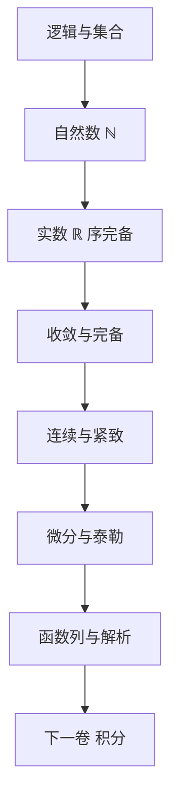

# 《分析 I》点化学习系统

## 这本书在讲什么

Amann–Escher 的第一卷从皮亚诺公理出发，把自然数一路构造到复数，再用序完备性立起实数分析的骨架：极限、连续、紧致、微分、函数列。它不假设读者有直觉，凡是"显然"的地方都要证；凡是未定义的概念都不使用。读懂它的收益不是多知道几个定理，而是学会"只用已证内容推理"。

## 全书心智模型

## 学习路径（推荐顺序）

| 步骤 | 章节 | 主题 | 前置 | 检查点 |
|---|---|---|---|---|
| 01 | ch01 | 数系、序完备、可数性 | 无 | ch01 自测三题 |
| 02 | ch02 | 极限、柯西、级数 | ch01 | ch02 自测三题 |
| 03 | ch03 | 连续、紧致、连通 | ch02 | ch03 自测三题 |
| 04 | ch04 | 微分、中值、泰勒、迭代 | ch03 | ch04 自测三题 |
| 05 | ch05 | 一致收敛、解析、逼近 | ch04 | ch05 自测三题 |

## 章节索引

- 第 1 章 基础（难度 ★★☆）→ chapters/ch01-foundations.md
- 第 2 章 收敛性（难度 ★★☆）→ chapters/ch02-convergence.md
- 第 3 章 连续函数（难度 ★★☆）→ chapters/ch03-continuity.md
- 第 4 章 一元微分学（难度 ★★☆）→ chapters/ch04-differentiation.md
- 第 5 章 函数序列（难度 ★★★）→ chapters/ch05-function-sequences.md

## 前置知识（零基础缺口补讲）

| 缺口 | 对应补讲位置 | 学完标志 |
|---|---|---|
| 不会写 ε 论证 | ch02 概念 1、概念 2 | 能独立写出“极限唯一”的证明 |
| 没学过集合与映射 | ch01 概念 1 | 能读懂 f : X → Y 与 f⁻¹(V) |
| 不熟悉上确界 | 概念页 上确界与序完备性 | 能说明 ℚ 为何不完备 |
| 没见过一致收敛 | ch05 概念 1、概念 2 | 能判断 xⁿ 在哪个区间一致 |

## 术语表 / 模式库 / 速查表 入口

- 术语：glossary.md
- 模式：patterns.md
- 速查：cheatsheet.md
- 测验：quiz.md
- 卡片：flashcards.md
