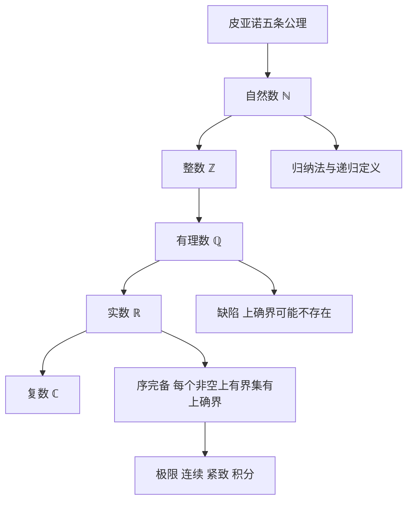

# 第 1 章：基础

- **难度**：★★☆ ｜ **预估学时**：8 小时 ｜ **前置**：无（只要求会用不等式、会做代数变形）

> 原书开篇把整章的任务说得很直接：从自然数的皮亚诺公理出发，依次构造整数、有理数、实数，最后是复数；每一步都在解一类"自然出现"的方程。作者还特意声明，这一章可以跳过某些长证明，但"基础"必须认真过一遍。

## 学习目标

学完本章，你能：
1. 写出皮亚诺五条公理，并解释为什么数学归纳法不是"经验规律"而是公理的第 5 条。
2. 用"非空上有界子集必有上确界"这条性质说明 ℚ 缺了什么、ℝ 补上了什么。
3. 判断一个集合是可数还是不可数，并给出双射或对角线论证。

## 一句话核心

实数之所以是实数，不是因为它"含有无理数"，而是因为它**序完备**：任何非空上有界子集都有上确界。分析学后面所有极限、连续、紧致、积分的存在性，最终都靠这条性质兜底。

## 零基础讲解

### 概念 1：为什么先学逻辑和集合

分析学的每个定理都要写成"若 A 则 B"的形式。要做到不靠直觉，先得把话说清楚。

- **陈述**：能判断真假的句子。"正在下雨"是陈述；"这句话是假的"不是，因为它无论真假都自相矛盾。
- **量词**：∀（对所有）、∃（存在）。这两个符号的否定最容易写错：¬(∀x: E(x)) 等于 ∃x: ¬E(x)，而不是 ∀x: ¬E(x)。"本书每位读者都戴眼镜"的否定是"至少有一位不戴"，不是"没有一位戴"。
- **集合**：{x ∈ X ; E(x)} 表示 X 中满足性质 E 的那些元素。这里没有"所有集合的集合"这种危险对象，本书只在已知集合上做子集运算。
- **函数**：f : X → Y 是一个规则，给 X 中每个元素指定 Y 中唯一元素。它不等于"公式"，也不要求"能算出来"。

**类比**：逻辑记号像合同条款。合同里"乙方应在 30 日内……"和"乙方不得晚于 30 日……"是一回事，但"并非所有条款都适用"和"所有条款都不适用"差得很远。写数学证明就是把合同条款逐条对齐。
**类比的边界**：合同有歧义可以打官司，数学陈述只有真/假两值，中间没有"部分成立"。

### 概念 2：自然数不是"数出来的"，是公理规定的

皮亚诺的做法是：不定义"自然数是什么"，只规定它满足什么。

1. 0 ∈ ℕ。
2. 每个 n ∈ ℕ 有唯一的后继 ν(n) ∈ ℕ。
3. ν(n) ≠ 0（0 不是任何数的后继）。
4. ν 是单射：ν(m) = ν(n) 推出 m = n。
5. **归纳公理**：若 S ⊆ ℕ 满足 0 ∈ S 且 n ∈ S ⇒ ν(n) ∈ S，则 S = ℕ。

第 5 条是关键。它把"从 0 开始，一个接一个，能到达每个自然数"这件事变成了公理。没有它，你可以构造出"0,1,2,… 再加上一个无穷远点"的怪模型，归纳法就失效。

有了这五条，加法、乘法、序关系都要**定义**出来，再**证明**交换律、结合律、分配律。书中用递归定义 m + 0 := m、m + ν(n) := ν(m + n)，然后对 n 作归纳证明 m + n = n + m。这不是"显然"，是一步步证出来的。

**类比**：国际象棋的规则不描述棋子的物理形状，只规定它怎么走。自然数公理就是"数的走法"。
**边界**：棋规可以任意改，自然数公理不行——改了就不再是算术，归纳法、递归定义都会崩。

### 概念 3：数系扩张的每一步，都在补一类解不出来的方程

| 从 | 到 | 要解出的方程 | 手法 |
|---|---|---|---|
| ℕ | ℤ | x + a = b | 用有序对 (m, n) 表示 m − n，按"差相同"划等价类 |
| ℤ | ℚ | a x = b（a ≠ 0） | 用有序对 (p, q) 表示 p/q，按"交叉相乘相等"划等价类 |
| ℚ | ℝ | x² = 2 | 补上序完备性（戴德金分割的第三条性质） |
| ℝ | ℂ | x² + 1 = 0 | 用有序对 (a, b) 表示 a + i b，规定 i² = −1 |

注意手法是统一的：**先造一个更大的集合，再按某个等价关系把元素粘起来**。整数不是"负号和自然数拼起来"这么随意，它是一个商结构：两个有序对 (m, n) 与 (m′, n′) 被视为同一个整数，当且仅当 m + n′ = m′ + n。

**类比**：分数 1/2 和 2/4 是同一个数，不是两个数。有理数的构造就是把"写法不同但值相同"的表达式装进同一个袋子。
**边界**：这套商构造在 ℚ→ℝ 时失灵——两个有理数列可能"应该收敛到同一个实数"，但极限本身还没造出来。所以 ℝ 的构造要么用分割（只谈集合的上界），要么用柯西列的完备化（先有度量再取商），不能照抄分数那套。

### 概念 4：序完备性——ℝ 与 ℚ 的真正分界

**上界**：若对每个 a ∈ A 都有 a ≤ s，则 s 是 A 的上界。**上确界** sup A 是"最小的上界"。

序完备性：每个非空、上有界的子集都有上确界。

ℚ 不满足。取 A := {x ∈ ℚ ; x > 0 且 x² < 2}。A 非空（1 ∈ A），上有界（2 是上界）。假设 c ∈ ℚ 是上确界。书中给出一个显式的改进：令 ξ := (2c + 2)/(c + 2)，则 ξ > 0 且

ξ − c = −(c² − 2)/(c + 2)。

若 c² < 2，则 ξ > c，ξ 仍是 A 的上界，与 c 最小矛盾；若 c² > 2，则 ξ < c 且 ξ 仍是上界，c 不是最小上界。若 c² = 2，则 c 不是有理数（√2 无理）。三种情况都矛盾，所以 sup A 在 ℚ 中不存在。

ℝ 里这个上确界就是 √2。整个实数分析就是在这个"缺口被填上"的世界里做。

**类比**：ℚ 像一把刻度无限细的尺子，但某些长度没有刻度；ℝ 把每个"该有刻度"的位置都补上了。
**边界**：完备性只保证上确界存在，不保证能算出来。√2 存在，但你写不出它的有限小数。

### 概念 5：可数性——无穷也分大小

集合 X **可数**，如果存在双射 X → ℕ（有限集也算可数）。否则不可数。

- ℤ 可数：排成 0, 1, −1, 2, −2, …
- ℚ 可数：把 p/q 按 |p| + q 分组排列，去掉重复。这反直觉但有双射。
- ℝ 不可数：康托对角线。假设 ℝ 可数，把 [0,1] 里的数写成小数并排成表，构造一个数，其第 n 位与表中第 n 个数的第 n 位不同，这个数不在表里，矛盾。

**类比**：可数不是"能数完"，是"能排队领号，每个元素恰好拿到一个号"。ℚ 元素稠密，但可以领号；ℝ 连领号都做不到。

### 概念 6：群、环、域——给运算立法

- **群**：一个集合配一个运算，满足结合律、有单位元、每元有逆元。整数对加法成群，非零有理数对乘法成群。
- **环**：加法成群，乘法满足结合律与分配律。ℤ、多项式环 K[X] 都是环。
- **域**：交换环，且每个非零元有乘法逆元。ℚ、ℝ、ℂ 是域。
- **同态**：保持运算的映射。群同态保乘法，环同态保加法和乘法。

这些概念在后面反复出现：连续函数空间、算子代数、函数域。它们不是"抽象废话"，而是让你一次证明、到处使用。

## 图示

**看图说明**：竖线是数系扩张的顺序，每一步都在补方程的解。右边两条分支说明：归纳法来自 ℕ 的公理；分析学的全部存在性定理来自 ℝ 的序完备性，而不是来自"数很密"。

## 类比与实例

**类比**：把数系想成工具箱。ℕ 只有锤子（加法），ℤ 加了螺丝刀（减法），ℚ 加了扳手（除法），ℝ 加了水平仪（极限），ℂ 加了能旋转的接头（开方）。工具越往后越强，但每一件都必须由前一件造出来，不能凭空出现。
**失效边界**：工具箱类比暗示"工具越多越好"，实际上每扩一步都丢掉一些性质：ℂ 不再是序域，你没法说 1 和 i 谁大。

**实例（可验证）**：证明 √2 ∉ ℚ。设 √2 = p/q，p、q 互素。则 p² = 2q²，所以 p² 偶，p 偶，p = 2k。代回得 4k² = 2q²，即 q² = 2k²，q 也偶。这与 p、q 互素矛盾。
这个证明只用"整数分解为 2 的幂"这一件事，不涉及极限，说明 ℚ 的缺口是纯代数层面就能看到的。

## 常见误解

- **别以为"实数 = 有理数 + 无理数"就够了** — 实际上关键在序完备性。你完全可以在 ℚ 里加入所有代数数，得到的域仍然不完备：{x : x² < 2} 仍然没有上确界。
- **别以为"可数"就是"能一个一个数出来"** — 实际上可数只要求存在双射到 ℕ。ℚ 稠密到任意两个数之间还有数，却仍然可数；ℝ 连这种排队都做不到。
- **别以为归纳法能证明"所有 n 都成立"是显然的** — 实际上归纳法是皮亚诺第 5 条公理。去掉它，存在满足前四条却让归纳法失效的模型。

## 自测题（答案）

1. 下列哪个集合在 ℚ 中没有上确界？　A. {x ∈ ℚ : x < 1}　B. {x ∈ ℚ : x² < 2, x > 0}　C. {x ∈ ℚ : 0 ≤ x ≤ 1}　D. {x ∈ ℚ : x² < 4, x > 0}
   **答案**：B。**解析**：A 的上确界是 1，C 是 1，D 是 2，都在 ℚ 中。B 的上确界是 √2，不在 ℚ 中；书中用 ξ = (2c+2)/(c+2) 的构造证明任何有理上界都能被改进。

2. 关于皮亚诺公理，哪条保证了数学归纳法可用？　A. 0 ∈ ℕ　B. 后继是单射　C. 归纳公理（第 5 条）　D. 0 不是后继
   **答案**：C。**解析**：前四条刻画"后继链"，只有第 5 条排除"链外还有多余元素"的模型，归纳才能覆盖整个 ℕ。

3. 下列判断正确的是？　A. ℚ 不可数　B. ℝ 可数　C. ℤ 与 ℚ 都可数　D. 有限集不可数
   **答案**：C。**解析**：ℤ 可按 0,1,−1,2,−2,… 排队；ℚ 可按 |p|+q 分组排队。ℝ 由康托对角线不可数；有限集按定义可数。

## 复习锚点

- 序完备性：非空上有界必有上确界。ℚ 缺它，ℝ 有它。
- 数系扩张的统一手法：造大集合 + 按等价关系取商。
- 可数 = 存在到 ℕ 的双射；稠密不等于不可数。
