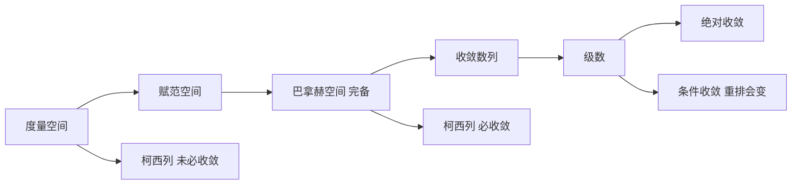

# 第 2 章：收敛性

- **难度**：★★☆ ｜ **预估学时**：9 小时 ｜ **前置**：第 1 章（上确界、域、可数性）

> 原书在引入数列时给了一个很朴素的说法：我们只能对序列做有限次求值，永远无法"到达无穷"，所以必须发展一些方法，使我们能证明关于"无穷附近"无穷多个函数值的命题。这一章就是这些方法的集合。

## 学习目标

学完本章，你能：
1. 用 ε-N 语言证明一个数列的极限，并能否定"收敛"。
2. 区分度量空间、赋范空间与巴拿赫空间，说明为什么需要完备性。
3. 用单调有界定理、波尔查诺–魏尔斯特拉斯定理判断收敛，用比值/根值判别法判断级数收敛。

## 一句话核心

收敛的意思是"从某一项起，所有项都落在任意小的误差带里"。把"某一项"的 N 与 ε 挂钩，是全部计算和证明的起点；而完备性保证"看起来该收敛的柯西列"真的收敛，这是 ℝ 区别于 ℚ 的度量版本。

## 零基础讲解

### 概念 1：为什么需要度量

要谈"接近"，先得有距离。集合 X 上的度量 d : X × X → ℝ 满足三条：

- d(x, y) = 0 当且仅当 x = y；
- d(x, y) = d(y, x)；
- d(x, y) ≤ d(x, z) + d(z, y)（三角不等式）。

第三条是全部估计技巧的来源：想证明 x 和 y 近，可以绕道 z，分别估计两段。ℚ、ℝ、ℂ 用 d(x, y) = |x − y|；ℝⁿ 可以用欧氏距离，也可以用 |x₁| + … + |xₙ| 或 max|xᵢ|。

**类比**：度量是城市之间的距离表。三角不等式就是"直达不会比绕城更远"。**边界**：有些空间（比如只有"开集"没有距离的拓扑空间）根本给不出距离表，那时收敛要用邻域重新定义。

### 概念 2：ε-N 定义，以及它的否定

数列 (xₙ) 收敛到 a：对每个 ε > 0，存在 N ∈ ℕ，使得 n ≥ N 时 |xₙ − a| < ε。

三个细节决定成败：

- ε 是任意的，不是"某个很小的数"。证明时必须让 ε 保持字母身份，不能代入 0.001 就算完。
- N 可以依赖 ε，通常写成 N(ε)。允许 N 很大，只要有限。
- 只要求"从 N 以后"，前面有限多项怎么乱都无所谓。极限是尾部行为。

否定形式（证明不收敛时用）：存在某个 ε₀ > 0，使得对每个 N，都能找到 n ≥ N 满足 |xₙ − a| ≥ ε₀。也就是说，存在一条固定的误差带，数列无穷多次跑出带外。

**类比**：验收标准。"合格"意味着无论你把误差标准定得多严，工厂从某一天起都能达标；"不合格"意味着存在一个标准，工厂无论怎么生产都会反复超差。

### 概念 3：赋范空间与等价范数

赋范空间是向量空间配一个范数 ‖·‖，由 d(x, y) := ‖x − y‖ 得到度量。范数要满足正定性、齐次性、三角不等式。

在 ℝⁿ 上，‖x‖₁ = Σ|xᵢ|、‖x‖₂ = (Σxᵢ²)½、‖x‖∞ = max|xᵢ| 给出同一个收敛概念：它们互相被常数控制，单位球互相包含（B∞ ⊆ B₂ ⊆ √m B∞ 一类的不等式）。所以"在哪个范数下收敛"在有限维不是问题。无限维就不同了，这一点第 7 章讲连续线性映射时会再遇到。

### 概念 4：单调有界必收敛

ℝ 中递增且有上界的数列收敛，极限等于其上确界。

证明只用一条：上确界是最小上界。设 s = sup{xₙ}。给定 ε > 0，s − ε 不是上界，所以存在 N 使 x_N > s − ε。由递增，n ≥ N 时 s − ε < xₙ ≤ s，即 |xₙ − s| < ε。

这条定理的威力在于：你不需要猜到极限是多少，只要证明"递增 + 有上界"，收敛性和极限的存在性一起拿到。e = lim(1 + 1/n)ⁿ 就是这样定义的：先证 (1 + 1/n)ⁿ 递增有界，再把这个上确界命名为 e。

**类比**：往一个固定容量的瓶子里注水，水位只升不降，那它一定停在某个高度。**边界**：瓶子必须有盖（有上界）；没有上界时水位趋于无穷，不收敛。

### 概念 5：柯西列与完备性

柯西列：对每个 ε > 0，存在 N，使得 m, n ≥ N 时 |xₘ − xₙ| < ε。它只谈"项与项之间越来越近"，不谈极限是谁。

- 收敛 ⇒ 柯西列。因为尾巴都在 a 附近，两项之间距离 ≤ 2ε。
- 柯西列 ⇒ 有界，但不一定收敛。在 ℚ 里，取 √2 的截断小数序列，它是柯西列，极限不在 ℚ 中。

空间**完备**：每个柯西列都收敛。ℝ、ℂ、ℝⁿ、巴拿赫空间都完备。

实数系的一个漂亮事实：ℝ 可以看作"有理柯西列全体，按'差趋于 0'取商"，序由逐项比较的上极限定义。这解释了为什么"补上极限"和"补上上确界"是同一件事的两种说法。

**类比**：柯西列是一群人说"我们互相越来越靠近"，但没人说清要靠近谁；完备性保证这群人确实有个落脚点。

### 概念 6：级数与绝对收敛

级数 Σxₖ 的收敛定义为部分和序列 sₙ = x₀ + … + xₙ 收敛。

- 必要条件：xₙ → 0。但它不是充分条件，调和级数 Σ1/n 的通项趋于 0 却发散。
- 正项级数：部分和单调递增，所以"收敛 ⇔ 部分和有界"。
- 比较、比值、根值判别法都来自和几何级数比较。
- **绝对收敛**：Σ‖xₖ‖ 收敛。在巴拿赫空间里，绝对收敛 ⇒ 收敛（用柯西准则 + 三角不等式）。反过来不成立：交错调和级数收敛但绝对值级数发散。
- **条件收敛的级数重排会变**。1 − 1/2 + 1/3 − … 可以重排成收敛到任意指定值，甚至发散。有限次加法有交换律，无限次没有。

**类比**：绝对收敛是"行李总重量有限"，条件收敛是"正负行李互相抵消，总重量其实无穷"。重排就是把正负行李换顺序，抵消关系一变，结果就变。

### 概念 7：幂级数与收敛半径

Σ aₙ (z − z₀)ⁿ 的收敛集合一定是一个以 z₀ 为心的圆盘（可能含边界点）。半径由 Cauchy–Hadamard 公式给出：1/R = limsup |aₙ|¹/ⁿ。圆内绝对收敛，圆外发散，圆上逐点判定。

这条结论是第 5 章解析函数和第 6 章傅里叶级数的技术底座。

## 图示

**看图说明**：从左往右是"结构越加越多"。关键对比是 C 与 A：同一个柯西列，在完备空间里有极限，在一般度量空间里可能没有。级数的两条分支说明"绝对"与"条件"的差别不在收敛与否，而在能不能随便换顺序。

## 类比与实例

**类比**：ε-N 像快递时效承诺。"3 天内送达"必须对每一单都成立；"大部分 3 天到"不是承诺。N(ε) 是"从第几单开始达标"，它当然可以随标准变严而变大。
**失效边界**：快递有个物理上限，N 可能大到超出任何实际意义；数学只要求 N 存在且有限，不要求能算出来。

**实例（可验证）**：证明 lim (1 + 1/n)ⁿ 存在。
先证递增：用二项式展开比较相邻两项，第 k 项系数从 C(n,k)/nᵏ 变为 C(n+1,k)/(n+1)ᵏ，逐项变大。再证有界：展开后每项 ≤ 1/k! ≤ 1/2ᵏ⁻¹，求和 ≤ 3。于是由单调有界定理收敛，极限记为 e ≈ 2.71828。
这个例子里没有"猜极限"，只有"单调 + 有界"两个可验证条件，这正是该定理的用法。

## 常见误解

- **别以为"有界数列必收敛"** — 实际上 0,1,0,1,… 有界但不收敛。有界 + 单调才够，或者有界 + 存在唯一聚点才够（波尔查诺–魏尔斯特拉斯只给聚点，不给唯一性）。
- **别以为"柯西列就是收敛列"** — 实际上这只在完备空间成立。ℚ 中 √2 的截断小数是柯西列，却没有有理极限。
- **别以为"通项趋于 0 就收敛"** — 实际上调和级数 Σ1/n 的通项趋于 0，部分和却无界。判别级数要看部分和，不要只看通项。

## 自测题（答案）

1. 数列 xₙ = (−1)ⁿ 的收敛情况是？　A. 收敛到 1　B. 收敛到 −1　C. 不收敛　D. 收敛到 0
   **答案**：C。**解析**：取 ε₀ = 1，任何 N 之后都能找到奇偶两项，它们的距离是 2，不满足柯西条件，因此不收敛。

2. 下列空间哪一个不完备？　A. ℝ　B. ℂ　C. ℚ（通常度量）　D. ℝ²
   **答案**：C。**解析**：取 √2 的截断小数，它是 ℚ 中的柯西列但极限不在 ℚ 中。ℝ、ℂ、ℝ² 都完备。

3. 关于级数，正确的说法是？　A. 通项趋于 0 则级数收敛　B. 绝对收敛必定收敛（在巴拿赫空间）　C. 条件收敛的级数重排后仍收敛到同一值　D. 收敛级数必定绝对收敛
   **答案**：B。**解析**：A 错，调和级数；C 错，重排可改变和甚至发散；D 错，交错调和级数收敛但绝对值级数发散。

## 复习锚点

- ε-N 的三个要点：ε 任意、N 依赖 ε、只管尾部。
- 单调有界定理不需要猜极限；它把存在性变成两个可检查的条件。
- 完备性 = 柯西列必收敛；ℝ 的完备性与序完备性是同一件事的两种面孔。
