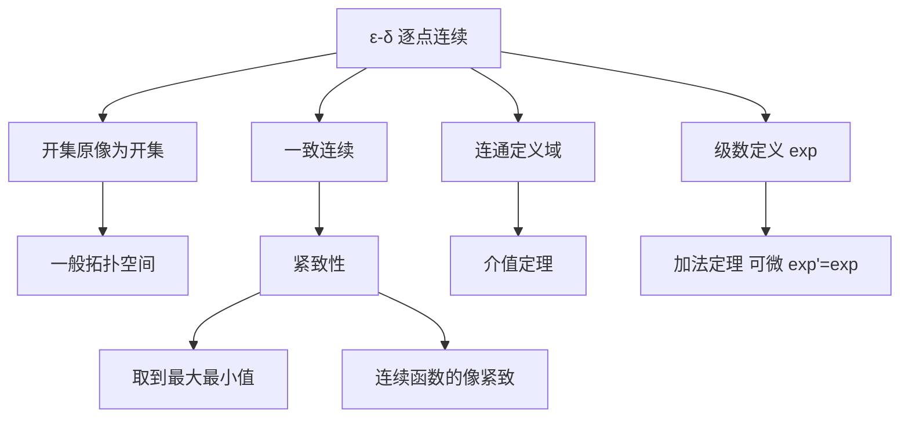

# 第 3 章：连续函数

- **难度**：★★☆ ｜ **预估学时**：8 小时 ｜ **前置**：第 2 章（度量、收敛、完备性）

> 原书对连续性的定位很克制：它衡量的是"像集中的微小变化如何由定义域中的微小变化引起"。为了说清"微小"，先得给集合加上结构——度量空间是最自然的候选。

## 学习目标

学完本章，你能：
1. 用 ε-δ 和"开集的原像是开集"两种语言判断连续，并证明二者等价。
2. 用紧致性证明连续函数取到最大值、最小值，并给出一致连续的结论。
3. 用连通性证明介值定理，说明为什么定义域必须连通。

## 一句话核心

连续是把"足够小的输入扰动"翻译成"任意小的输出误差"的能力；紧致性把这个逐点成立的局部性质升级成全局性质（一致连续、取到极值），连通性则保证值域不出现跳跃。

## 零基础讲解

### 概念 1：ε-δ 定义

f : X → Y 在 x₀ 处连续：对每个 ε > 0，存在 δ = δ(x₀, ε) > 0，使得 d_X(x, x₀) < δ 时 d_Y(f(x), f(x₀)) < ε。

和数列的 ε-N 比，多了一个麻烦：δ 一般依赖 x₀。这正是"逐点连续"与"一致连续"的分水岭。证明 √x 在 x₀ = 0 连续时要取 δ = ε²，在其他点取 min{ε√x₀, x₀}，δ 的表达式随点变，这不是偷懒，是必须的。

**类比**：调收音机。每个频段的灵敏度不同，想收到清晰信号，不同频段要拧不同的幅度。连续就是"每个频段都能调到足够清晰"，但允许每个频段的拧法不同。

### 概念 2：开集语言（拓扑）

在度量空间中，开球 B(a, r) 是开集；开集是若干开球的并。三条基本事实：

- 任意并的开集是开集；
- 有限交的开集是开集；
- ∅ 与全空间是开集。

定理：f 连续 ⇔ 每个开集 V ⊆ Y 的原像 f⁻¹(V) 是 X 中的开集。

为什么等价？若 f 在每点连续，取 x ∈ f⁻¹(V)，V 开所以含一个球 B(f(x), ε)，连续性给出 B(x, δ) 落在原像里，于是原像是开集。反过来，给定 ε，取 V = B(f(x₀), ε)，它的原像是开集且含 x₀，于是含某个球 B(x₀, δ)，这就是 ε-δ。

开集语言的好处：它不依赖距离，可以搬到一般拓扑空间。第 9 章的 σ-代数、第 11 章的流形都用这套"用原像搬运结构"的思路。

### 概念 3：紧致性

度量空间 X 紧致：每个开覆盖都有有限子覆盖。等价的序列说法：每个序列都有收敛子列（在度量空间里二者等价）。

最常用的例子：[a, b] 紧致（Heine–Borel），ℝ 不紧致，开区间 (0,1) 不紧致。ℓ∞ 的闭单位球不紧致——这是无限维与有限维的重要差别。

紧致性的三条常用推论：

1. 紧集上的连续函数**有界**且**取到最大最小值**。证明用序列紧致：取逼近上确界的点列，抽出收敛子列，连续性把极限传到函数值。
2. 紧集上的连续函数**一致连续**。给定 ε，每点有 δ(x)；若没有统一的 δ，就能找到 xₙ、yₙ 使 |xₙ − yₙ| < 1/n 而 |f(xₙ) − f(yₙ)| ≥ ε；紧性抽出收敛子列，两点极限相同，连续性给矛盾。
3. 紧集在连续映射下的像紧致。

**类比**：紧致像一个"不会漏气的盒子"：无论你用多少个小盖子去盖它，总能挑出有限个就盖住。开区间会漏气——靠近端点的地方，有限的盖子盖不住。

### 概念 4：连通性与介值定理

X 连通：不能拆成两个不交非空开集之并。ℝ 中连通的集合恰好是区间。

介值定理：f : [a, b] → ℝ 连续，则 f 取到 f(a) 与 f(b) 之间的一切值。

证明思路：设 y 在两端值之间，令 A = {x : f(x) ≤ y}，取 c = sup A。由连续性，f(c) 既不能小于 y（否则 c 附近还有点在 A 中，c 不是上确界），也不能大于 y（否则 c 左边附近都不在 A 中，c 不是最小上界），只能等于 y。

注意两点：定义域必须是连通的区间；值域必须是 ℝ 这种有序、有介值概念的空间。对复值函数或向量值函数，介值定理不成立（可以绕圈）。

**类比**：爬山。起点 100 米、终点 800 米，只要路线连续，你一定在某个时刻踩过 500 米。绕圈的山路（复平面）就不保证——高度不再是单值的。

### 概念 5：指数函数怎么"定义"出来

初等数学里 e^x 是"乘方"，但 x 是无理数时没法用"乘 x 次"定义。分析学的做法是从级数出发：

exp(z) := Σ zⁿ/n!。

这个级数在整个 ℂ 上绝对收敛（比值判别），所以定义良好。由级数的绝对收敛可以做柯西乘积，得到加法定理 exp(z + w) = exp(z)exp(w)，进而推出 exp 连续、可微、exp′ = exp。e := exp(1)，e^x 就是 exp(x)。

这条路线把"指数"从直观变成定理：不是假设它存在，而是造出来再证明它有该有的性质。第 4 章用它做例子，第 6 章用它做 Fourier 级数的核。

## 图示

**看图说明**：连续的定义有两条等价道路（左：ε-δ，右：开集），往下分三条支线：紧致给出"整体"结论，连通给出"介值"，级数给出具体函数的构造。三条支线的共同点都是"用连续把局部信息传成全局结论"。

## 类比与实例

**类比**：连续像电梯。按钮按 3 楼，电梯必须经过 2 楼（介值）；电梯行程有限、一定停在某层（紧致 + 极值）；但按钮的灵敏度在不同楼层可能不同（逐点 δ 依赖 x₀）。
**失效边界**：电梯是离散楼层，数学的连续是实数级别；而且电梯可能故障（不连续），这时介值、极值全都不保证。

**实例（可验证）**：f(x) = x² 在 ℝ 上连续但非一致连续。
连续：|x² − x₀²| = |x + x₀||x − x₀|，取 δ = min{1, ε/(2|x₀| + 1)} 即可。
非一致：取 xₙ = n，yₙ = n + 1/n。|xₙ − yₙ| = 1/n → 0，但 |xₙ² − yₙ²| = 2 + 1/n² ≥ 2。所以不存在对全 ℝ 统一的 δ。
这个反例说明"逐点连续 + 定义域不紧致"确实会失去一致连续。

## 常见误解

- **别以为"连续就是不间断、能一笔画出来"** — 实际上连续允许函数无限振荡（x sin(1/x) 在 0 处补定义为 0 后连续），也允许处处不可微（Weierstrass 函数）。"一笔画"是直觉，不是定义。
- **别以为"连续就有最大值"** — 实际上 f(x) = x 在 (0,1) 上连续，却没有最大值。必须定义域紧致。
- **别以为"介值定理对向量值函数也成立"** — 实际上 f(t) = (cos t, sin t) 从 (1,0) 到 (−1,0)，中途不经过原点，值域是圆周不是区间。介值需要一维有序值域。

## 自测题（答案）

1. f(x) = 1/x 在 (0, 1) 上的一致连续性如何？　A. 一致连续　B. 连续但非一致连续　C. 不连续　D. 只在 (1/2,1) 上一致连续
   **答案**：B。**解析**：取 xₙ = 1/n，yₙ = 1/(n+1)，两点距离趋于 0，函数值之差恒为 1，不存在统一 δ。定义域不紧致，正是一致连续失效的典型场景。

2. 下列条件中，能保证连续函数 f : X → ℝ 取到最小值的是？　A. X 是开区间　B. X 紧致　C. f 有界　D. X 连通
   **答案**：B。**解析**：紧集上连续函数取到最大最小值。开区间、连通都不够（f(x)=x 在 (0,1) 无最小值）；仅有界也不够。

3. 介值定理成立的必要条件不包括？　A. 定义域连通　B. 函数连续　C. 值域是一维有序的　D. 函数可微
   **答案**：D。**解析**：介值定理只用连续性，不要求可微。A、B、C 都是必需的：去掉连通（定义域分裂）、去掉连续（跳跃）、或换成复值，结论都会失效。

## 复习锚点

- 连续两条等价语言：ε-δ 与开集原像；后者是拓扑推广的入口。
- 紧致 = 开覆盖有有限子覆盖 = 序列有收敛子列，能把"逐点"升级为"整体"。
- 一致连续失败的标准反例：定义域不紧致 + 两点靠近而函数值拉开。
