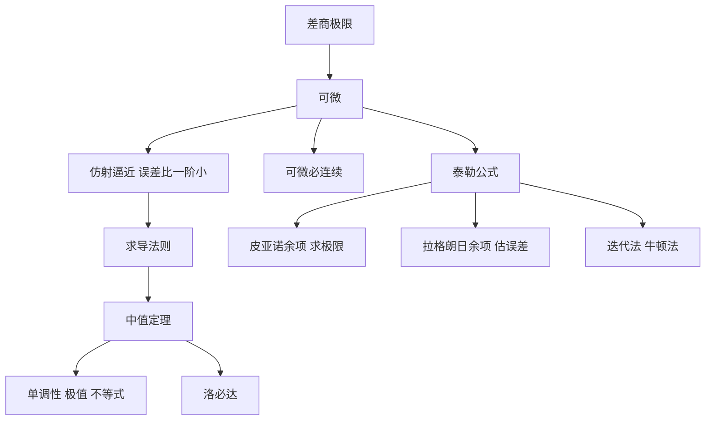

# 第 4 章：一元微分学

- **难度**：★★☆ ｜ **预估学时**：8 小时 ｜ **前置**：第 2 章（极限）、第 3 章（连续）

> 原书一开头就把动机摆明：发展微分学，是希望用线性近似描述函数的局部行为。由此引出切线问题，再引出极值、密切圆这些相关问题。

## 学习目标

学完本章，你能：
1. 用"差商极限"和"存在仿射逼近使误差比 |x − a| 更快趋零"两种说法定义可微，并证明等价。
2. 用罗尔、拉格朗日、柯西中值定理证明单调性、极值、洛必达法则与不等式。
3. 写出带皮亚诺余项与拉格朗日余项的泰勒公式，并估计余项。
4. 说明牛顿迭代为什么二次收敛，以及它的失败条件。

## 一句话核心

可微就是"在一点附近，函数可以被一条直线替代，误差是比一阶更小的量"。微分学的全部结论——中值定理、泰勒公式、极值判别——都是把这句话在不同尺度上展开。

## 零基础讲解

### 概念 1：导数与线性逼近

f 在 a 处可微，如果差商 (f(x) − f(a))/(x − a) 当 x → a 时有极限，记为 f′(a)。

等价刻画：存在 m ∈ E 与在 a 处连续、且 r(a) = 0 的函数 r，使得

f(x) = f(a) + m(x − a) + r(x)(x − a)。

这里 m = f′(a)，r(x)(x − a) 就是"比一阶更小的误差"。换成一句更直观的话：f 在 a 处可以被仿射函数 g(x) = f(a) + f′(a)(x − a) 逼近，且

‖f(x) − g(x)‖ / |x − a| → 0。

由此立刻得到：可微 ⇒ 连续。因为误差项 r(x)(x − a) → 0。反过来不成立：|x| 在 0 处连续但差商左右极限不同。

**类比**：导数是你踩油门那一刻的速度表读数。它只描述"此刻"，不描述"这一秒走了多远"。**边界**：速度表总有读数，函数却可能在某点没有导数（尖角、振荡），这时"瞬时速度"不存在。

### 概念 2：求导法则都来自线性化

- 和、数乘：线性化可以直接相加。
- 乘积法则 (fg)′ = f′g + fg′：把 f(a+h)g(a+h) 展开，主项之外剩下 f′g + fg′。
- 链式法则 (f∘g)′(a) = f′(g(a)) g′(a)：复合两个线性逼近，误差是二阶小量。
- 反函数求导：(f⁻¹)′(y) = 1/f′(x)，只要 f′(x) ≠ 0。几何上是切线斜率的倒数。

这些法则不是"公式表"，是同一条"误差比一阶小"的思想在运算下的封闭性。

### 概念 3：中值定理家族

**罗尔定理**：f 在 [a, b] 连续、在 (a, b) 可微、f(a) = f(b)，则存在 ξ 使 f′(ξ) = 0。
证明：连续函数在紧区间上取到最大最小值。若极值在内部，导数必为 0；若两端就是极值，则函数常数，处处导数为 0。

**拉格朗日中值定理**：存在 ξ 使 f(b) − f(a) = f′(ξ)(b − a)。把罗尔定理用在 f(x) − f(a) − k(x − a) 上，k 取割线斜率。

**柯西中值定理**：f、g 都满足条件时，

(f(b) − f(a)) g′(ξ) = (g(b) − g(a)) f′(ξ)。

它是洛必达法则的引擎：把"两个函数之比的极限"转化成"导数之比在中间点的值"。

三个推论最常用：

1. f′ ≡ 0 ⇒ f 常数。
2. f′ > 0 ⇒ f 严格递增。
3. |f′| ≤ M ⇒ |f(b) − f(a)| ≤ M|b − a|（利普希茨）。

**类比**：中值定理说"平均速度必然在某一瞬间被达到"。开车 2 小时走 160 公里，平均 80，那么必有某一刻速度表指 80。**边界**：只保证存在某一刻，不保证你能知道是哪一刻；而且要求路程连续、可导，急刹车（不可导）时结论可能失效。

### 概念 4：泰勒公式

若 f 在 a 处 n 次可微，则

f(x) = f(a) + f′(a)(x − a) + f″(a)(x − a)²/2! + … + f⁽ⁿ⁾(a)(x − a)ⁿ/n! + Rₙ(x)。

两种余项：

- **皮亚诺余项**：Rₙ(x) = o(|x − a|ⁿ)。只保证"高阶小"，适合求极限。
- **拉格朗日余项**：Rₙ(x) = f⁽ⁿ⁺¹⁾(ξ)(x − a)ⁿ⁺¹/(n + 1)!，ξ 在 a 与 x 之间。能给出具体误差界，适合估计。

用法示例：e^x = 1 + x + x²/2 + … + xⁿ/n! + e^ξ xⁿ⁺¹/(n+1)!。在 |x| ≤ 1 时误差 ≤ 3/(n+1)!，取 n = 10 就能保证小数点后 6 位。

**类比**：泰勒多项式是"用多项式模仿函数"的逐步加码版：常数项对齐函数值，一次项对齐斜率，二次项对齐弯曲程度，每加一项就多对齐一阶导数。**边界**：模仿只在展开点附近有效；离得远，误差可能爆炸（比如 1/(1−x) 在 |x| > 1 时级数发散）。

### 概念 5：极值判别与洛必达

- 一阶必要：内部极值点且可微 ⇒ f′ = 0。反之不成立（x³ 在 0 处）。
- 二阶充分：f′(a) = 0 且 f″(a) > 0 ⇒ 严格局部极小；f″(a) < 0 ⇒ 极大；f″(a) = 0 时失效，要更高阶或直接看单调性。
- 洛必达：0/0 或 ∞/∞ 型，若 f′/g′ 有极限，则 f/g 同极限。条件是邻域内 g′ ≠ 0，且别在"导数之比不存在"时硬套。

### 概念 6：迭代法与牛顿法

求方程 f(x) = 0 的根，可以写成不动点问题 x = T(x)，迭代 xₙ₊₁ = T(xₙ)。

**压缩映射原理**：若 T 是完备度量空间上的压缩（d(Tx, Ty) ≤ L d(x, y)，L < 1），则 T 有唯一不动点，且从任意点迭代都收敛，误差按 Lⁿ 衰减。

**牛顿法**：T(x) = x − f(x)/f′(x)。在单根附近，若 f 二阶连续可微且 f′ ≠ 0，则误差满足 eₙ₊₁ ≈ C eₙ²，即有效位数每步翻倍（二次收敛）。代价是每步要算导数，且初值必须落在吸引域内；f′ 接近 0 或根为重根时会退化。

**类比**：牛顿法像用切线当滑梯，一次滑到切线与 x 轴的交点。滑梯越陡（导数越大）滑得越准，接近水平时（导数趋 0）会滑飞。**边界**：函数有多个根时，不同初值可能滑向不同根；初值选错会发散。

## 图示

**看图说明**：所有箭头都从"可微 = 线性逼近"出发。中值定理是"一次近似"的全局版本，泰勒是"高阶近似"的局部版本，牛顿法是"用一阶近似反过来求根"。三条支线用的都是同一句话。

## 类比与实例

**类比**：把函数想成地形，导数就是坡度。中值定理说"起点和终点高度差等于某处坡度乘以水平距离"；泰勒公式说"用当地坡度、弯曲度、弯曲的变化率来预测附近高度"；牛顿法说"沿着当前坡度直走，走到高度为零的地方，再重新测坡度"。
**失效边界**：地形有悬崖（不连续）或尖石（不可导）时，坡度不存在；雾天（高阶导数巨大）时，预测会偏得很远。

**实例（可验证）**：证明对任意 x > 0，log x ≤ x − 1。
令 f(x) = x − 1 − log x。f(1) = 0，f′(x) = 1 − 1/x。x < 1 时 f′ < 0，f 递减；x > 1 时 f′ > 0，f 递增。所以 1 是全局最小点，f(x) ≥ f(1) = 0。
这个证明只用了"导数符号决定单调性"，属于中值定理的直接推论。

## 常见误解

- **别以为"导数为 0 就是极值点"** — 实际上 x³ 在 0 处导数为 0，却不是极值。必要条件和充分条件要分清。
- **别以为"函数连续就差不多可微"** — 实际上连续函数可以处处不可微（Weierstrass 函数），也可以在某点有尖角（|x| 在 0）。可微是比连续强得多的要求。
- **别以为"泰勒多项式就是函数本身"** — 实际上它只是局部近似，余项不为 0；在收敛半径外，级数甚至不收敛到函数。

## 自测题（答案）

1. f(x) = |x| 在 x = 0 处？　A. 可微且导数为 0　B. 连续但不可微　C. 不连续　D. 可微但导数不存在
   **答案**：B。**解析**：左右差商分别为 1 和 −1，极限不存在，所以不可微；但函数本身连续。

2. 设 f 在 [0, 2] 上可微，f(0) = 0，f(2) = 4，则一定能推出？　A. 存在 ξ 使 f′(ξ) = 2　B. f′ 处处等于 2　C. f 单调递增　D. f″ 存在
   **答案**：A。**解析**：拉格朗日中值定理给出 f(2) − f(0) = f′(ξ)(2 − 0)，即 f′(ξ) = 2。其余三项都不保证。

3. 用牛顿法求 f(x) = x² − 2 的正根，初值 x₀ = 1，迭代式为？　A. xₙ₊₁ = (xₙ + 2/xₙ)/2　B. xₙ₊₁ = xₙ − xₙ²　C. xₙ₊₁ = 2/xₙ　D. xₙ₊₁ = xₙ + 1
   **答案**：A。**解析**：x − f/f′ = x − (x² − 2)/(2x) = (x + 2/x)/2，这是求平方根的标准迭代，误差平方级下降。

## 复习锚点

- 可微的两种说法：差商极限、仿射逼近且误差比一阶小。
- 中值定理把局部导数信息变成全局结论；泰勒是它的高阶版。
- 牛顿法 = 用切线求根，二次收敛但依赖初值和 f′ ≠ 0。
