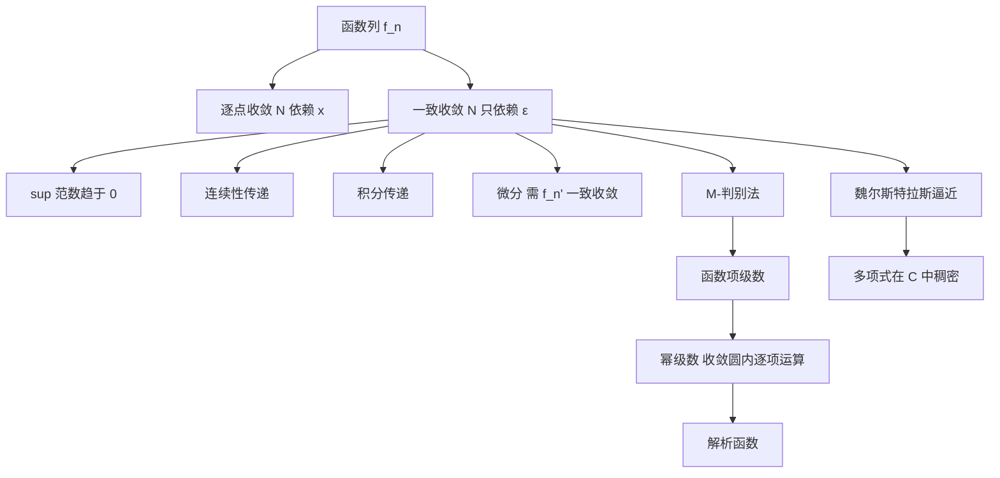

# 第 5 章：函数序列

- **难度**：★★★ ｜ **预估学时**：10 小时 ｜ **前置**：第 2 章（收敛）、第 3 章（连续）、第 4 章（导数）

> 原书把这一章称为"所有更深入分析研究的基础"，并在第 1 节就把逐点收敛与一致收敛的差别点破：一致收敛时，N 只依赖 ε，不依赖 x。

## 学习目标

学完本章，你能：
1. 判断一个函数列是逐点收敛还是一致收敛，并用 sup 范数重写一致收敛。
2. 用魏尔斯特拉斯 M-判别法证明函数项级数一致收敛。
3. 说明一致收敛能传递连续性、积分，但传递微分需要更强的条件。
4. 解释解析函数为什么可以局部展开成幂级数，以及魏尔斯特拉斯逼近定理说了什么。

## 一句话核心

逐点收敛只管每个点各自达标，一致收敛要求所有点共用同一个 N。只有后者才能让"极限"与"连续、积分、求导"交换次序。

## 零基础讲解

### 概念 1：逐点收敛与一致收敛

设 fₙ : X → E。

- **逐点收敛**：对每个 x 和每个 ε > 0，存在 N = N(x, ε)，使 n ≥ N 时 ‖fₙ(x) − f(x)‖ < ε。
- **一致收敛**：对每个 ε > 0，存在 N = N(ε)，使 n ≥ N 时，**对所有 x ∈ X** 都有 ‖fₙ(x) − f(x)‖ < ε。

差别只在 N 是否依赖 x，但后果很大。看两个例子：

1. fₙ(x) = xⁿ 在 [0,1] 上逐点收敛到 f(x) = 0（x < 1 时）和 f(1) = 1。极限函数不连续，而每个 fₙ 都连续。所以逐点收敛不能传递连续性。
2. 同一列在 [0, a]（a < 1）上一致收敛到 0：‖fₙ‖ ≤ aⁿ → 0。区间换成闭区间、离开 1，一致收敛就回来了。

**类比**：逐点收敛是每个学生各自及格，标准可以因人而异；一致收敛是全班的及格线统一，而且从某一堂课起全班同时达标。**边界**：一致收敛比逐点强，但不是"更强就更好"——有些函数列只有逐点收敛，仍然有分析价值（比如傅里叶级数在间断点附近）。

### 概念 2：用 sup 范数重写

对有界函数，定义 ‖f‖∞ := sup{‖f(x)‖ : x ∈ X}。则

fₙ 一致收敛到 f ⇔ ‖fₙ − f‖∞ → 0。

这把一致收敛变成了一个普通数列的收敛问题，所有判别法都能用。代价是：只有有界函数才有有限的 sup 范数，处理无界函数时要先局部化（在紧集上讨论）。

### 概念 3：一致收敛能传递什么

设 fₙ 一致收敛到 f。

- **连续性**：每个 fₙ 连续 ⇒ f 连续。证明用"三段估计"：‖f(x) − f(x₀)‖ ≤ ‖f(x) − fₙ(x)‖ + ‖fₙ(x) − fₙ(x₀)‖ + ‖fₙ(x₀) − f(x₀)‖。第一、三段由一致收敛统一控制，中间段由 fₙ 的连续性控制。这里"统一"是关键，逐点收敛时第一、三段各自依赖 x，拼不起来。
- **积分**：在紧区间上，∫fₙ → ∫f。估计是 ‖∫fₙ − ∫f‖ ≤ (b − a)‖fₙ − f‖∞。
- **微分**：光有一致收敛不够。fₙ(x) = sin(nx)/n 一致收敛到 0，但 fₙ′ = cos(nx) 不收敛。正确条件是：fₙ 在某点收敛，且 fₙ′ 一致收敛，则 f 可微且 f′ = lim fₙ′。

**类比**：一致收敛像"整批货物同时到港"，所以可以把整批直接转给下一道工序；逐点收敛像"零散到货"，每件到的时间不同，没法整批处理。

### 概念 4：M-判别法与函数项级数

若 ‖fₙ‖∞ ≤ Mₙ 且 ΣMₙ 收敛，则 Σfₙ 一致收敛（且绝对收敛）。

这是最常用的判别法，因为它把函数项级数化归成正项级数。例：Σ xⁿ/n² 在 [−1,1] 上一致收敛，因为 |xⁿ/n²| ≤ 1/n²，而 Σ1/n² 收敛。

注意：M-判别法给的是充分条件，不是必要。Σ(−1)ⁿ xⁿ/n 在 [0,1] 上一致收敛（用交错级数的余项估计），但 M-判别法失效。

### 概念 5：解析函数

f 在 a 处**解析**：存在 r > 0，使得在 |z − a| < r 内

f(z) = Σ cₙ (z − a)ⁿ，cₙ = f⁽ⁿ⁾(a)/n!。

关键事实：

- 幂级数在收敛圆内可以逐项求导、逐项积分，且收敛半径不变。这正是一致收敛在紧子集上的应用（在 |z − a| ≤ ρ < r 上一致收敛）。
- 解析 ⇒ 无穷次可微，但反过来不成立：C∞ 函数不一定解析（经典的 e^(−1/x²) 在 0 处所有导数都是 0，幂级数恒为 0，不收敛到函数本身）。
- 解析函数由它在一点的所有导数决定，这是它"刚性"的一面：知道一点的全部局部信息，就知道整个连通区域。

**类比**：解析函数像全息底片，一小块包含整个物体的信息；C∞ 函数像高清照片，局部再清晰也不能推出远处。**边界**：全息只在收敛圆内成立，圆外要另找展开点（解析延拓）。

### 概念 6：多项式逼近

**魏尔斯特拉斯逼近定理**：紧区间上的连续函数可以用多项式一致逼近。

证明思路（Bernstein 多项式）：Bₙ(f)(x) = Σ f(k/n) C(n,k) xᵏ(1−x)ⁿ⁻ᵏ。它是"以二项分布权重对 f 的取值做平均"，均值是 x，方差 ≤ 1/(4n)，所以 n 大时平均集中在 x 附近，收敛到 f(x)。用 f 的一致连续性把"集中在 x 附近"翻译成"值接近 f(x)"。

这条定理说明：多项式在 C[a,b] 中稠密。它不构造实用算法（Bernstein 收敛慢），但保证了存在性。

## 图示

**看图说明**：中间那条"一致收敛"是主干。左边逐点收敛只通向"每点各自收敛"，右边四条才是它带来的可用结论。注意微分那条有个附加条件，这是最容易踩的坑。

## 类比与实例

**类比**：把函数列想成一群演员排练同一段戏。逐点收敛是"每个观众席看到的表演都越来越好"，但不同座位看到的时间点不同；一致收敛是"整场演出同时到位"，导演才能整体切换场景。
**失效边界**：一致收敛要求所有 x 同步，现实里"同步"很难；数学上很多有用的逼近（如傅里叶级数在间断点）只有逐点收敛，靠额外技巧（分段一致、狄利克雷核）补救。

**实例（可验证）**：证明 fₙ(x) = nx/(1 + n²x²) 在 [0,1] 上逐点收敛到 0，但不一致收敛。
逐点：固定 x > 0，fₙ(x) ≈ 1/(nx) → 0；x = 0 时为 0。
非一致：取 xₙ = 1/n，则 fₙ(xₙ) = 1/2，始终不小于 1/2。所以不存在统一的 N。
这个例子的极限函数连续（恒为 0），但收敛仍不一致，说明"极限连续"不能反推一致收敛。

## 常见误解

- **别以为"每个 fₙ 连续 + 逐点收敛 ⇒ 极限连续"** — 实际上 xⁿ 在 [0,1] 就是反例。必须一致收敛。
- **别以为"一致收敛 ⇒ 可以逐项求导"** — 实际上 sin(nx)/n 一致收敛到 0，导数却剧烈振荡。求导要额外要求导数列一致收敛。
- **别以为"无穷次可微就是解析"** — 实际上 e^(−1/x²) 在 0 处 C∞，但泰勒级数恒为 0，不等于函数本身。

## 自测题（答案）

1. fₙ(x) = xⁿ 在下列哪个区间上一致收敛到 0？　A. [0,1]　B. [0,1)　C. [0, 0.9]　D. (−1,1]
   **答案**：C。**解析**：在 [0,1] 上极限函数在 1 处跳到 1，不一致；[0,0.9] 上 ‖fₙ‖ ≤ 0.9ⁿ → 0，一致收敛。[0,1) 上取 xₙ → 1 可使 fₙ(xₙ) 不趋于 0。

2. 若 fₙ 一致收敛到 f，且每个 fₙ 连续，则？　A. f 一定可微　B. f 一定连续　C. fₙ′ 一定一致收敛　D. f 一定有界
   **答案**：B。**解析**：一致收敛传递连续性。可微、导数收敛都不保证；f 在有界区间上才有界，题干没说 X 有界。

3. 关于解析函数，正确的说法是？　A. 解析与 C∞ 等价　B. 解析函数在收敛圆内可逐项求导　C. 解析函数的泰勒级数处处收敛到自身　D. 解析函数一定是有理函数
   **答案**：B。**解析**：A 错（e^(−1/x²)）；C 错，只在收敛圆内；D 错，exp、sin 都是超越函数。

## 复习锚点

- 逐点与一致的唯一差别：N 是否依赖 x；一切后果由此而来。
- 一致收敛传递连续与积分；传递微分要导数列一致收敛。
- 解析 = 局部幂级数展开；C∞ 不够。
