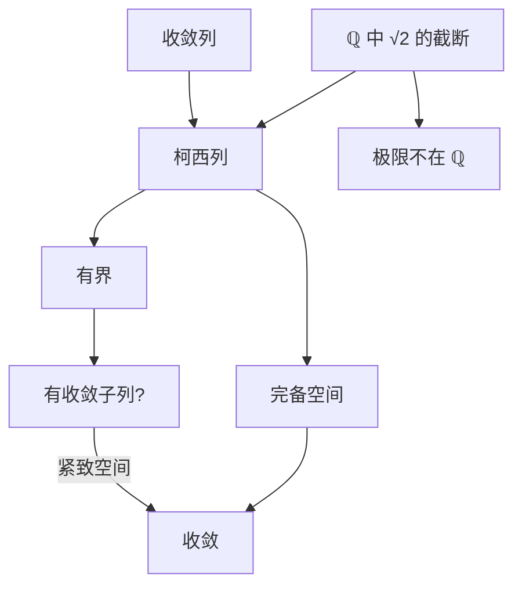

# 柯西列与完备性

- **难度**：进阶 ｜ **涉及章节**：第 2 章（§1、§6）、第 3 章（§3）

## 一句话定义

柯西列是"项与项之间越来越近"的数列；完备性是"每个柯西列都真的收敛到空间里的某个点"。

## 为什么重要

它把"收敛"从"知道极限是谁"变成"只看数列自己"。在证明存在性（不动点、积分、微分方程解）时，通常拿不到极限的显式表达式，只能拿到柯西估计。完备空间保证这一步不落空。ℝ、ℂ、Banach 空间都靠它工作。

## 图示

## 详解

柯西：对每个 ε > 0，存在 N，使 m, n ≥ N 时 ‖xₘ − xₙ‖ < ε。

- 收敛 ⇒ 柯西：两项都在 a 的 ε 邻域内，距离 ≤ 2ε。
- 柯西 ⇒ 有界：取 ε = 1，N 之后所有项落在球 B(x_N, 1) 内，前面有限项取最大距离。
- 柯西 ⇏ 收敛（一般度量空间）。ℚ 中取 √2 的十进截断 1, 1.4, 1.41, 1.414, …，它是柯西列，极限不在 ℚ。

完备：柯西列必收敛。ℝ 完备，这是序完备性的度量版本。证明用波尔查诺–魏尔斯特拉斯：柯西列有界，故有收敛子列，柯西性质把整个序列拖到同一极限。

完备化的思想：把"所有柯西列"按"差趋于 0"等价分类，得到的商空间就是原空间的完备化。ℚ 的完备化是 ℝ；连续函数空间按 sup 范数完备化得到有界函数空间的一部分。

**类比**：柯西列是一群人互相越走越近，但没说在哪儿集合；完备性是保证"他们一定有个共同的目的地"。**边界**：目的地必须在空间内。ℚ 的人可以越走越近，最终"站在 √2 上"，但 √2 不在 ℚ 的地图上。

## 常见误解

- 别以为柯西列一定收敛——只在完备空间成立。
- 别以为"有界 + 柯西"就够——有界是必要条件，柯西比有界强，但仍需完备性才能落地。
- 别以为完备性只跟度量有关——同一个集合换度量可以改变完备性，比如 (0,1) 用通常度量不完备，但它与 ℝ 等距同构的度量下完备。

## 在书中出现的脉络

| 章节 | 语境 | 关键结论 |
|---|---|---|
| 第 2 章 §1 | 度量空间 | 收敛定义、柯西定义 |
| 第 2 章 §6 | 完备性 | 柯西列收敛，ℝ 完备 |
| 第 3 章 §3 | 紧致 | 紧致度量空间完备 |
| 第 7 章 §1 | 算子空间 | L(E,F) 在 F 完备时完备 |

## 相关概念

- 前置：度量空间、上确界
- 后续：巴拿赫空间、压缩映射、Lp 完备性
