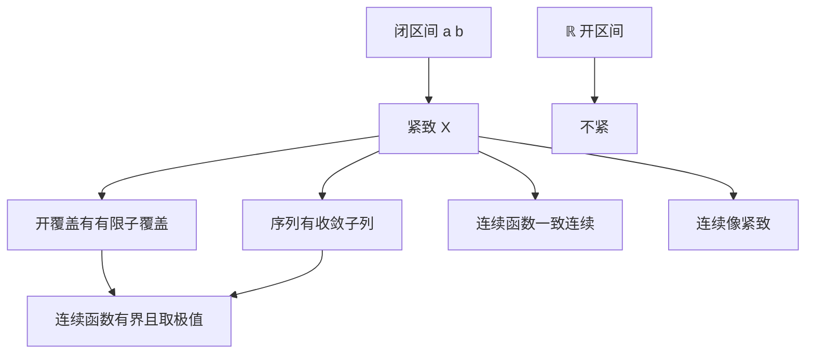

# 紧致性

- **难度**：进阶 ｜ **涉及章节**：第 3 章（§3）、第 4 章（§2）

## 一句话定义

紧致是"每个开覆盖都有有限子覆盖"；在度量空间里等价于"每个序列都有收敛子列"。

## 为什么重要

它把逐点的局部性质升级成整体性质：连续函数在紧集上取到极值、一致连续、像紧致。中值定理、极值定理、积分存在性都依赖它。无限维空间里紧集变得稀少（ℓ∞ 的闭单位球不紧），这也是泛函分析要另起炉灶的原因。

## 图示

## 详解

开覆盖：一族开集，其并包含 X。紧致：从中总能挑出有限个仍然覆盖 X。

− 闭区间 [a, b] 紧致（Heine–Borel）：有界 + 闭。
− ℝ 不紧：开覆盖 {(n − 1, n + 1) : n ∈ ℤ} 没有有限子覆盖。
− (0,1) 不紧：{(1/n, 1) : n ≥ 2} 覆盖它，但有限个盖不住靠近 0 的部分。
− ℓ∞ 的闭单位球不紧：单位向量 eₙ 两两距离为 1，没有收敛子列。

关键推论：连续 f : X → ℝ 在紧 X 上取到最小值。取 xₙ 使 f(xₙ) → inf f，序列紧致给出子列 x_{nₖ} → x，连续性给出 f(x) = inf f。没有紧致性，inf 可能取不到（f(x) = x 在 (0,1)）。

**类比**：紧致像一个"任何漏洞都能用有限块补丁补上"的容器。开区间在端点处需要无限多补丁，所以不紧。**边界**：紧致是拓扑性质，不是"有界闭"的同义词；在一般度量空间里，有界闭不一定紧。

## 常见误解

- 别以为"有界闭 = 紧"——这只在 ℝⁿ 成立（Heine–Borel），无限维空间不成立。
- 别以为"紧集的子集紧"——紧集的闭子集紧，开子集不一定。
- 别以为紧致只关于覆盖——序列紧致与开覆盖紧致在度量空间等价，在一般拓扑空间不等价。

## 在书中出现的脉络

| 章节 | 语境 | 关键结论 |
|---|---|---|
| 第 3 章 §3 | 紧致性 | 连续函数取极值、一致连续 |
| 第 4 章 §2 | 中值定理 | 闭区间上连续函数取极值 |
| 第 6 章 §3 | 积分 | 紧区间上阶梯函数逼近 |
| 第 10 章 §9 | 傅里叶变换 | 紧支集、速降函数 |

## 相关概念

- 前置：开集、连续
- 后续：一致连续、积分、流形的紧性
