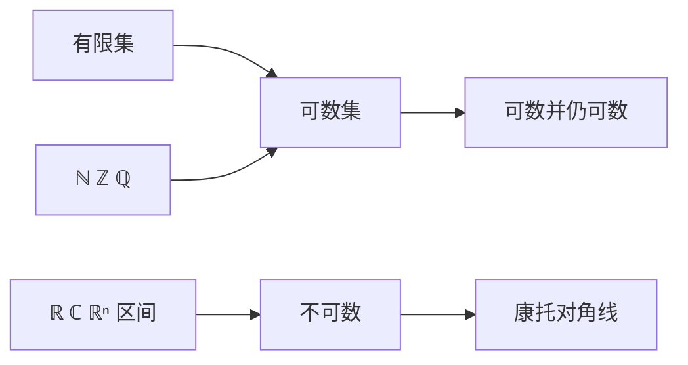

# 可数与不可数

- **难度**：基础 ｜ **涉及章节**：第 1 章（§6）、第 2 章（§9）

## 一句话定义

可数就是能和自然数建立一一对应；不可数就是做不到。ℚ 可数，ℝ 不可数。

## 为什么重要

它区分了两种"无穷"，也决定了"能不能把对象排队处理"。级数求和、算法枚举、测度论里"可数并"的封闭性，都建立在可数性上。ℝ 不可数正是勒贝格测度必须引入"可数覆盖"而不是"有限覆盖"的原因。

## 图示

## 详解

可数：存在双射 X → ℕ。

- ℤ：0, 1, −1, 2, −2, …，每个整数拿到唯一编号。
- ℚ：把 p/q 按 |p| + q 分层，逐层列出，重复的跳过。任意给定 p/q，它必落在有限层内，所以能编到号。
- 可数个可数集的并可数：用对角线法把二维编号压成一维。
- ℝ 不可数：假设 [0,1] 可数，列出小数展开 a₁, a₂, …，构造 b，使 b 的第 n 位与 aₙ 的第 n 位不同（并避开 9 与 0 的重复表示问题）。b 在 [0,1] 中却不在表中，矛盾。

**类比**：可数是旅馆房间号，每个客人一个号；不可数是"客人比房间号还多，无论怎么编号总有客人没号"。**边界**：无限旅馆（希尔伯特旅馆）说明可数集可以和真子集等势，所以"房间满了还能再住人"，这与有限直觉相反。

## 常见误解

- 别以为"稠密就不可数"——ℚ 稠密但可数。
- 别以为"可数"意味着能数完——它只要求存在双射，不要求给出数完的时刻。
- 别以为"不可数"就是"比可数多一点点"——ℝ 的基数严格大于 ℕ，且不可数与可数之间没有中间基数（连续统假设的领域，超出本书）。

## 在书中出现的脉络

| 章节 | 语境 | 关键结论 |
|---|---|---|
| 第 1 章 §6 | 集合的势 | ℚ 可数，ℝ 不可数 |
| 第 2 章 §9 | 幂级数 | 收敛半径，圆内可数多个点逐点判定 |
| 第 9 章 §1 | σ-代数 | 可数并封闭 |

## 相关概念

- 前置：集合、双射
- 后续：σ-代数、勒贝格测度
