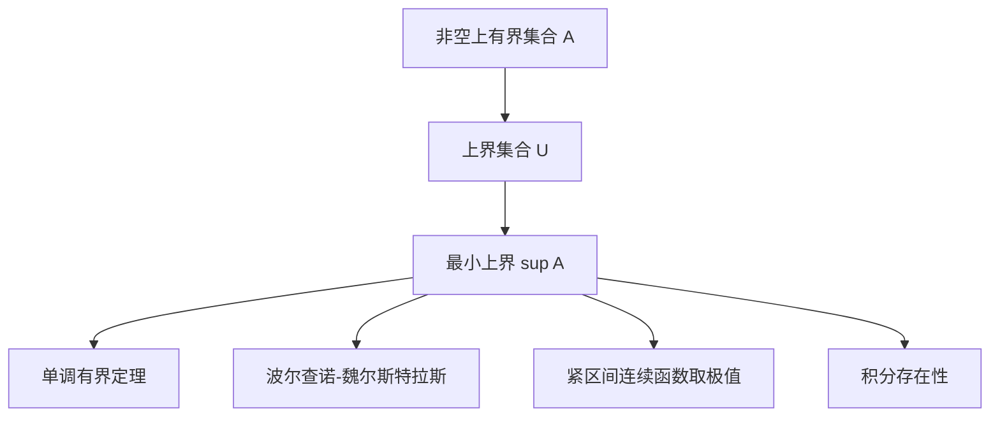

# 上确界与序完备性

- **难度**：基础 ｜ **涉及章节**：第 1 章（§10）、第 2 章（§4、§6）

## 一句话定义

上确界是最小的上界；序完备性是说每个非空、上有界的子集都有上确界。ℝ 满足，ℚ 不满足。

## 为什么重要

它是实数分析的总开关。单调有界定理、区间套、波尔查诺–魏尔斯特拉斯、连续函数取极值、积分的存在性，最后都归到"某个集合有上确界"。ℚ 里这些结论会逐条失效。

## 图示

## 详解

设 A ⊆ ℝ 非空。s 是上界：对所有 a ∈ A，a ≤ s。sup A 是上界中最小的那个。

ℝ 的构造性刻画：它是唯一（在同构意义下）的序完备有序域。ℚ 的失败例子是 A = {x ∈ ℚ : x > 0, x² < 2}。若 c ∈ ℚ 是上确界，令 ξ = (2c + 2)/(c + 2)，则 ξ − c = −(c² − 2)/(c + 2)。c² < 2 时 ξ 更大且仍是上界；c² > 2 时 ξ 更小且仍是上界；c² = 2 时 c 不是有理数。三种情况都推翻"最小上界"。

这个构造同时说明：上确界不必属于集合，也不必是有理数。A 没有最大元，上确界 √2 在集合外。

**类比**：一群人比身高，上确界是"最矮的那个够用的天花板"——比所有人都高，但再低一点就有人顶破。**边界**：人群必须有上界，否则没有天花板；空集也没有上确界（约定为 −∞）。

## 常见误解

- 别以为上确界一定在集合里——(0,1) 的上确界 1 不在集合内。
- 别以为"任意接近"就等于"等于"——A 中元素可以任意接近 √2，但没有一个等于 √2。
- 别以为有理数稠密就完备——稠密只说明任意两个数之间有数，不保证缺口被填上。

## 在书中出现的脉络

| 章节 | 语境 | 关键结论 |
|---|---|---|
| 第 1 章 §10 | 构造 ℝ | 序完备性公理，ℚ 不完备 |
| 第 2 章 §4 | 单调数列 | 递增有上界则收敛到上确界 |
| 第 2 章 §6 | 完备性 | 与柯西完备等价 |
| 第 3 章 §3 | 紧致性 | 闭区间紧致，连续函数取极值 |

## 相关概念

- 前置：全序集、域
- 后续：柯西列与完备性、紧致性
