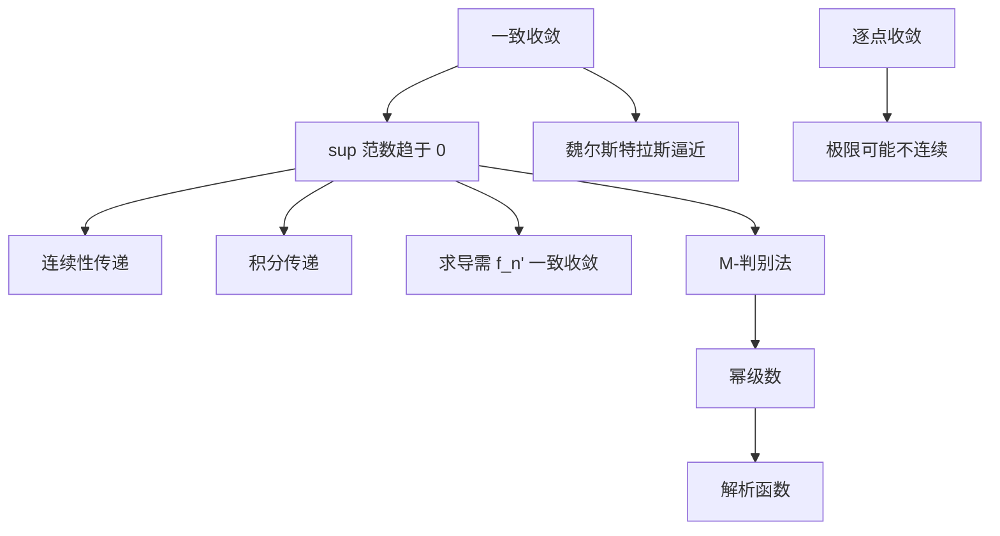

# 一致收敛

- **难度**：高难 ｜ **涉及章节**：第 5 章（§1–§4）、第 6 章（§7）

## 一句话定义

函数列 fₙ 一致收敛到 f，是指误差 sup|fₙ(x) − f(x)| 整体趋于 0，而不是每个点各自趋于 0。

## 为什么重要

它决定"极限能不能穿过运算符号"。连续、积分、求导、求和都是极限过程，只有一致收敛才能让两个极限交换次序。幂级数的逐项求导、傅里叶级数的收敛性、微分方程解的存在性，都靠这条。

## 图示

## 详解

逐点：∀x ∀ε ∃N(x, ε)。一致：∀ε ∃N(ε) ∀x。量词顺序不同，强弱就不同。

判别技巧：

1. 求 sup 误差：计算 ‖fₙ − f‖∞，若趋于 0 则一致。
2. M-判别法：‖fₙ‖∞ ≤ Mₙ，ΣMₙ 收敛 ⇒ Σfₙ 一致收敛。
3. 分段 + 单调（狄利克雷/阿贝尔判别）处理交错型级数。

三个经典反例：

- xⁿ 在 [0,1]：逐点收敛到不连续函数，非一致。
- nx/(1 + n²x²)：逐点收敛到 0，但 xₙ = 1/n 处取值 1/2，非一致。
- sin(nx)/n：一致收敛到 0，导数 cos(nx) 不收敛。

**类比**：一致收敛是"整支部队同时到达指定位置"，逐点收敛是"每个士兵各自到达"。只有整支部队同时到位，才能整体转入下一场战斗。**边界**：战场若无限大（定义域无界），"同时"很难实现；实践中常退而求其次，在紧子集上一致（局部一致）。

## 常见误解

- 别以为逐点收敛 + 连续函数列就能保住连续性——xⁿ 是标准反例。
- 别以为一致收敛就能逐项求导——还需要导数列一致收敛。
- 别以为 M-判别法是必要条件——它只是充分条件，Σ(−1)ⁿxⁿ/n 在 [0,1] 一致收敛但不满足 M-判别。

## 在书中出现的脉络

| 章节 | 语境 | 关键结论 |
|---|---|---|
| 第 5 章 §1 | 定义 | 逐点与一致的差别 |
| 第 5 章 §2 | 传递性 | 连续、积分、微分 |
| 第 5 章 §3 | 解析函数 | 幂级数逐项求导 |
| 第 5 章 §4 | 逼近 | 魏尔斯特拉斯定理 |
| 第 6 章 §7 | 傅里叶级数 | 部分和的一致收敛 |

## 相关概念

- 前置：数列收敛、连续、紧致
- 后续：解析函数、傅里叶级数、Lp 收敛
