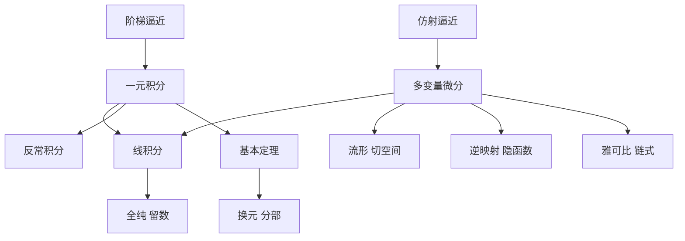

# 《分析 II》点化学习系统

## 这本书在讲什么

第二卷把第一卷的极限与连续工具用到三个新战场：一元积分、多变量微分、曲线上的积分。它的主线是"逼近"与"线性化"：积分用阶梯函数逼近，多变量导数用仿射映射逼近，线积分用 1-形式沿曲线累加。最后以全纯函数收尾，展示一维复分析如何把线积分理论变成留数计算。

## 全书心智模型

## 学习路径（推荐顺序）

| 步骤 | 章节 | 主题 | 前置 | 检查点 |
|---|---|---|---|---|
| 06 | ch06 | 积分、基本定理、反常积分 | 分析 I 第 3–5 章 | ch06 自测三题 |
| 07 | ch07 | 多变量微分、隐函数 | ch06 | ch07 自测三题 |
| 08 | ch08 | 曲线、线积分、全纯 | ch06、ch07 | ch08 自测三题 |

## 章节索引

- 第 6 章 一元函数的积分（难度 ★★★）→ chapters/ch06-integration.md
- 第 7 章 多变量微分学（难度 ★★★）→ chapters/ch07-multivariable.md
- 第 8 章 线积分（难度 ★★★）→ chapters/ch08-line-integrals.md

## 前置知识（零基础缺口补讲）

| 缺口 | 对应补讲位置 | 学完标志 |
|---|---|---|
| 不熟悉一致收敛 | 分析 I 第 5 章 | 能解释为什么积分要用一致逼近 |
| 不会算定积分 | ch06 概念 3、概念 4 | 能独立算 5 个常见积分 |
| 没接触过线性映射 | ch07 概念 1 | 能算 2×2 矩阵的算子范数 |
| 没学过复变 | ch08 概念 4 | 能验柯西–黎曼方程 |

## 术语表 / 模式库 / 速查表 入口

- 术语：glossary.md
- 模式：patterns.md
- 速查：cheatsheet.md
