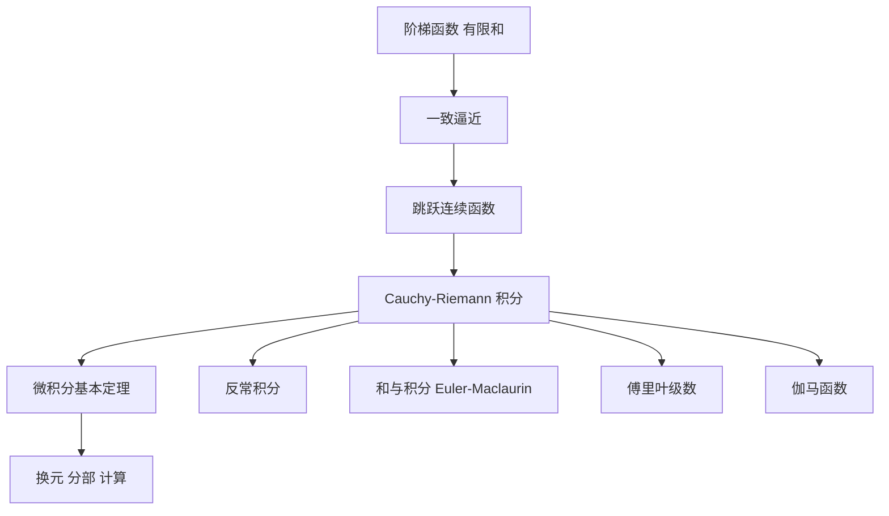

# 第 6 章：一元函数的积分

- **难度**：★★★ ｜ **预估学时**：12 小时 ｜ **前置**：第 3 章（连续、紧致）、第 4 章（微分）、第 5 章（一致收敛）

> 原书开头把积分的来历说得很朴素：积分是为了求面积发明的，基本策略是把图形切成矩形再相加。但"给定图形可以用无数种方式近似为矩形，它们是否都导致相同结果，绝非不言自明"——这句话就是整章要解决的问题。

## 学习目标

学完本章，你能：
1. 用阶梯函数的一致逼近定义积分，并说明为什么函数类要选"跳跃连续"。
2. 用微积分基本定理计算积分，用换元与分部积分处理复合与乘积。
3. 判断反常积分收敛，区分绝对收敛与条件收敛。
4. 写出傅里叶系数并说明逐点收敛的条件，用 Γ 函数把阶乘延拓到实数。

## 一句话核心

积分不是"面积"这个几何词的定义，而是"用阶梯函数一致逼近，再取极限"这套操作的产物；微积分基本定理则说明这套操作与求导互逆。

## 零基础讲解

### 概念 1：为什么先研究阶梯函数

阶梯函数：存在区间的一个分割 α = α₀ < α₁ < … < αₙ = β，使 f 在每个开区间 (αⱼ₋₁, αⱼ) 上是常数。它的积分可以直接定义成"高 × 宽"的和：

∫ f := Σ cⱼ (αⱼ − αⱼ₋₁)。

这个定义没有任何极限，纯粹是有限和。接下来的问题是：哪些函数能被阶梯函数**一致**逼近？

答案是**跳跃连续函数**：在每点 x 处，左右单侧极限 f(x−0)、f(x+0) 都存在（可以不等于 f(x)）。连续函数当然满足；分段连续函数（有限个跳跃点）也满足。这类函数构成向量空间 S(I, E)，并且在 sup 范数下，阶梯函数在其中稠密。

为什么必须一致逼近？如果只在每点分别逼近，逼近函数列的积分可能不收敛到同一个值。一致逼近才能保证"逼近的积分"是一个柯西列，从而有唯一极限。

**类比**：用方块拼出一幅画。允许每块方块的颜色随位置变（逐点逼近），拼出来的总面积可能随拼法剧烈变化；要求所有方块的误差都不超过一个统一上限（一致逼近），总面积才稳定。

### 概念 2：积分作为延拓

阶梯函数上的积分是一个线性映射，且满足两条基本估计：

- |∫f| ≤ ‖f‖∞ (β − α)；
- 阶梯函数空间在跳跃连续函数空间中稠密。

于是用"连续延拓定理"：一致连续（或利普希茨）映射在稠密子空间上的值可以唯一延拓到闭包。积分就这样从阶梯函数延拓到跳跃连续函数，记作 Cauchy–Riemann 积分。

由此得到可积性的实用判据：f 可积 ⇔ 存在阶梯函数列 φₙ 使 ‖f − φₙ‖∞ → 0。这也解释了为什么"可积"比"连续"宽：函数可以有有限个跳跃点，只要跳跃幅度有限。

**类比**：先在整数点上定义一个函数，再要求它"变化不太剧烈"，就能唯一地插值到所有实数点。积分就是这样一个被插值出来的量。

### 概念 3：微积分基本定理

设 f : [α, β] → E 连续，F(x) := ∫_α^x f。则 F 可微且 F′ = f。反过来，若 F 可微且 F′ = f，则 ∫_α^β f = F(β) − F(α)。

证明前半段只用估计：

‖(F(x + h) − F(x))/h − f(x)‖ = ‖(1/h)∫_x^{x+h} (f(t) − f(x)) dt‖ ≤ sup_{|t−x|≤h} ‖f(t) − f(x)‖，

由连续性趋于 0。后半段对 F − 原函数 用中值定理，导数为 0 故为常数。

这条定理把"求积分"从"算极限"变成"找原函数"，是整章计算能力的来源。

**类比**：积分是"把每天的收入累加"，导数是"当天收入"。基本定理说累加函数的日增量就是当天收入。

### 概念 4：换元与分部

- 换元：∫_a^b f(φ(t)) φ′(t) dt = ∫_{φ(a)}^{φ(b)} f(u) du。条件是 φ 连续可微、f 连续。
- 分部：∫ u′v = uv − ∫ uv′。它是乘积求导法则的积分版。

例：∫₀¹ x/(1+x²) dx。令 u = 1 + x²，du = 2x dx，得 (1/2)∫₁² du/u = (1/2)log 2。
例：∫ x e^x dx = x e^x − ∫ e^x dx = (x − 1)e^x + C。

### 概念 5：反常积分

两类：区间无界（∫_a^∞），或被积函数在端点无界（∫₀¹ 1/√x）。

定义都是"取极限"：∫_a^∞ f := lim_{b→∞} ∫_a^b f，只要极限存在且有限。

判据：

- 比较判别：0 ≤ f ≤ g，∫g 收敛 ⇒ ∫f 收敛。
- p-判别：∫_1^∞ 1/x^p 收敛 ⇔ p > 1；∫_0^1 1/x^p 收敛 ⇔ p < 1。
- **绝对收敛 ⇒ 收敛**（在完备空间中用柯西准则），但反之不成立：∫_1^∞ sin x / x 收敛，绝对值积分发散。

**类比**：反常积分像"无限长的账单分期付款"，只要每期金额下降得足够快，总额有限。**边界**：条件收敛的账单总额有限，但如果你按不同顺序重排收支，结果会变。

### 概念 6：和与积分、Euler–Maclaurin、Stirling

积分与求和通过阶梯逼近互相控制：

|Σ_{k=m}^{n} f(k) − ∫_m^n f| ≤ 变差项。

Euler–Maclaurin 公式把它展开成"积分 + 端点修正 + 导数修正"，用来近似求和。取 f(x) = log x 就得到 Stirling 公式：

log n! = (n + 1/2)log n − n + (1/2)log 2π + O(1/n)。

这不是"经验公式"，是由求和与积分之差逐阶展开推出来的。

### 概念 7：傅里叶级数

对周期 2π 的函数，定义系数

aₖ = (1/π)∫_{−π}^{π} f(x) cos(kx) dx，bₖ = (1/π)∫_{−π}^{π} f(x) sin(kx) dx，

部分和 Sₙ = a₀/2 + Σ(aₖ cos kx + bₖ sin kx)。

收敛性需要条件：分段连续 + 有界变差（狄利克雷条件）保证逐点收敛到 (f(x+0) + f(x−0))/2；连续性与导数平方可积能给出更强的一致收敛。只连续不足以保证逐点收敛（有反例），这说明傅里叶级数比幂级数"娇气"。

### 概念 8：Γ 函数

Γ(z) := ∫_0^∞ t^{z−1} e^{−t} dt，在 Re z > 0 收敛。

分部积分给出 Γ(z + 1) = z Γ(z)，且 Γ(1) = 1，所以 Γ(n + 1) = n!。这把阶乘从整数延拓到复数，是"用积分定义新函数"的范例。Γ 在正实轴上是凸函数（对数凸），这来自它的积分表示与 Hölder 不等式。

## 图示

**看图说明**：整章只有一个源头（阶梯函数的有限和），三条箭头分别通向计算（基本定理、换元分部）、收敛性（反常积分、傅里叶）、特殊函数（Γ）。理解"逼近 → 延拓"这条主线，后面的技巧才有归属。

## 类比与实例

**类比**：积分像用乐高积木拼曲面。阶梯函数是最小块的积木，一致逼近是"每块的高度误差都不超过一个统一上限"，基本定理是"知道每块积木的边界高度差，就能算出总体积"。
**失效边界**：积木只能拼出"高度有限、跳跃有限"的形状；遇到无穷高（1/√x 在 0）或无穷宽（∫_1^∞），必须另做极限处理。

**实例（可验证）**：计算 ∫₀^{π/2} sin²x dx。
用恒等式 sin²x = (1 − cos 2x)/2，得 ∫ = (1/2)[x − (sin 2x)/2]₀^{π/2} = π/4。
检验：数值上 sin² 在 [0, π/2] 的平均值应为 1/2，区间长 π/2，乘积 π/4，一致。

## 常见误解

- **别以为"积分就是面积"** — 实际上面积是几何直觉，积分的定义是逼近的极限。对变号函数、向量值函数，"面积"讲不通，但积分照样有定义。
- **别以为"可积函数必须连续"** — 实际上跳跃连续即可，甚至 Riemann 可积函数类还更宽（有界 + 间断点测度为零）。
- **别以为"反常积分收敛就是绝对收敛"** — 实际上 ∫ sin x/x 条件收敛，绝对值积分发散。
- **别以为"傅里叶级数一定收敛到函数本身"** — 实际上只连续不够；间断点处收敛到左右极限的平均值。

## 自测题（答案）

1. 下列关于跳跃连续函数的说法，正确的是？　A. 必须连续　B. 每点左右极限存在，可以不等于函数值　C. 只能有有限个间断点　D. 必须有界变差
   **答案**：B。**解析**：跳跃连续只要求单侧极限存在；分段连续才是"有限个跳跃点"的更强要求。跳跃连续函数在紧区间上自动有界。

2. ∫_1^∞ 1/x^p 收敛的条件是？　A. p > 0　B. p > 1　C. p < 1　D. 对所有 p 都收敛
   **答案**：B。**解析**：p > 1 时原函数 x^{1−p}/(1−p) 在无穷远处趋于 0；p ≤ 1 时发散。对照 ∫_0^1 1/x^p 的条件是 p < 1，两者方向相反。

3. Γ(5) 等于？　A. 5!　B. 4!　C. 5　D. 24/5
   **答案**：B。**解析**：Γ(n+1) = n!，所以 Γ(5) = 4! = 24。注意指标偏移一格，这是最容易记错的地方。

## 复习锚点

- 积分 = 阶梯函数一致逼近的极限；一致是关键。
- 基本定理：积分与微分互逆，计算靠找原函数。
- 反常积分看衰减速度；条件收敛不能重排。
