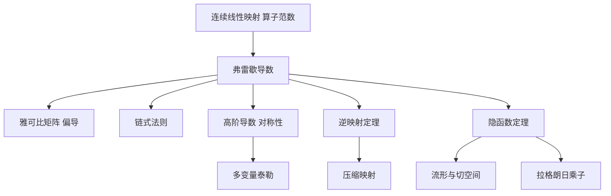

# 第 7 章：多变量微分学

- **难度**：★★★ ｜ **预估学时**：14 小时 ｜ **前置**：第 4 章（一元微分）、第 6 章（积分）、第 3 章（紧致）

> 原书把整章的思路压缩成一句话：多变量情形的微分依赖于仿射函数局部逼近的思想。非平凡的部分就是其中的线性映射，所以第 1 节先研究赋范空间之间的连续线性映射。

## 学习目标

学完本章，你能：
1. 用算子范数判断线性映射连续，并说明有限维为什么"所有范数等价"。
2. 写出弗雷歇导数的定义，区分"偏导存在"与"可微"。
3. 用链式法则求复合函数的雅可比矩阵。
4. 陈述逆映射定理与隐函数定理的条件，并用拉格朗日乘子解约束极值。

## 一句话核心

多变量导数不是数，是一个线性映射：f(a + h) = f(a) + A h + r(h)，其中 ‖r(h)‖/‖h‖ → 0。A 就是导数，在标准基下写成雅可比矩阵。

## 零基础讲解

### 概念 1：连续线性映射与算子范数

线性映射 A : E → F 连续 ⇔ 存在 C 使 ‖Ax‖ ≤ C‖x‖。等价的量是算子范数

‖A‖ := sup{‖Ax‖ : ‖x‖ ≤ 1}。

它把"最大放大倍数"变成一个数。由此得到 L(E, F) 是一个赋范空间；若 F 完备，则 L(E, F) 完备。这是第 1 节的主要定理，证明用柯西列逐点收敛 + 一致有界。

有限维空间里，所有范数等价：存在常数 c, C 使 c‖x‖₁ ≤ ‖x‖₂ ≤ C‖x‖₁。所以"在哪个范数下连续"这个问题在有限维没有意义，在无限维才有意义（例如多项式空间上 sup 范数与 L² 范数不等价）。

**类比**：算子范数是放大器的最大增益。连续就是"增益有限"，不连续就是"存在输入使输出爆掉"。

### 概念 2：弗雷歇导数

f : X ⊆ E → F 在 a 处可微：存在 A ∈ L(E, F)，使得

f(a + h) = f(a) + A h + r(h)，且 ‖r(h)‖/‖h‖ → 0（h → 0）。

A 记作 f′(a) 或 Df(a)。三个要点：

1. A 必须是**线性**的，"局部最佳仿射逼近"的线性部分。
2. 误差是 o(‖h‖)，即比一阶更快趋零。
3. 可微 ⇒ 连续，但反之不成立。

在 ℝⁿ → ℝᵐ 中，A 的矩阵就是雅可比矩阵 J = (∂fᵢ/∂xⱼ)。但要注意顺序：先有线性映射，矩阵只是它在标准基下的表示。

**类比**：把 f 想成一台多输入多输出的机器，导数是一张"局部传动比表"：输入微小变动 h，输出近似按 A h 变化。

### 概念 3：偏导存在不等于可微

经典反例：

f(x, y) = xy/(x² + y²)（(x,y) ≠ (0,0)），f(0,0) = 0。

在原点，两个偏导都存在且等于 0（沿坐标轴函数恒为 0）。但沿直线 y = x，f(x,x) = 1/2，不趋于 0，所以 f 在原点不连续，当然不可微。

正确的关系是：

- 可微 ⇒ 偏导存在，且 A 的矩阵由偏导组成；
- 偏导存在 + 偏导连续 ⇒ 可微（C¹ 条件）。

这条"连续"条件是充分条件，不是必要。做题时先查偏导是否连续，是最省事的判据。

### 概念 4：链式法则与高阶导数

若 g 在 a 可微、f 在 g(a) 可微，则 (f∘g)′(a) = f′(g(a)) ∘ g′(a)。写成矩阵就是雅可比相乘。

高阶导数：D²f(a) 是一个双线性映射 E × E → F，在有限维用 Hessian 矩阵表示。**对称性**：若 D²f 存在且连续，则 D²f(a)(h, k) = D²f(a)(k, h)（施瓦茨定理）。这条对称性在泰勒公式、极值判别、变分法中反复使用。

多变量泰勒公式：

f(a + h) = f(a) + Df(a)h + (1/2)D²f(a)(h, h) + o(‖h‖²)。

### 概念 5：逆映射定理

设 f : U → F 是 C¹，f′(a) 是拓扑同构（可逆且逆连续），则 f 在 a 附近是局部微分同胚：存在邻域 V，使 f|V 有 C¹ 逆，且 (f⁻¹)′(f(a)) = (f′(a))⁻¹。

条件是"导数可逆"，不是"函数单射"。一维时就是 f′(a) ≠ 0；多维时要雅可比行列式非零。证明用压缩映射原理：把 f(x) = y 改写成 x = x − A⁻¹(f(x) − y)，A = f′(a)，验证这是压缩。

**类比**：一张能被局部拉平的地图。只要该点的"拉伸率"不为零（雅可比可逆），附近就能一一对应地翻回去。

### 概念 6：隐函数定理

方程 F(x, y) = 0 在 (a, b) 附近能否解出 y = φ(x)？

条件：F(a, b) = 0，F 是 C¹，且 ∂F/∂y(a, b) 可逆。结论：存在 a 的邻域与唯一的 C¹ 函数 φ，使 φ(a) = b 且 F(x, φ(x)) = 0，并且

φ′(x) = −(∂F/∂y)⁻¹ (∂F/∂x)。

一维例子：x² + y² = 1 在 (0,1) 附近，∂F/∂y = 2y = 2 ≠ 0，可解出 y = √(1 − x²)；在 (1,0) 处 ∂F/∂y = 0，解不出单值函数（上下两支相交）。

### 概念 7：约束极值与拉格朗日乘子

求 f(x) 在约束 g(x) = 0 下的极值。若 ∇g(a) ≠ 0，则极值点满足

∇f(a) = λ ∇g(a)。

几何解释：f 的等值面与约束面在极值点相切，两个法向量平行。λ 是乘子，也解释为"约束放松一点，目标能改善多少"的影子价格。

条件是必要的，不是充分的：还要比较各候选点的函数值，并检查边界。

### 概念 8：流形、切空间、法向量

m 维流形 M ⊆ ℝⁿ：每点附近有坐标卡，把 M 局部拉平成 ℝᵐ。切空间 TₚM 是所有过 p 的曲线速度向量张成的空间，维数 m。法空间是它的正交补，维数 n − m。

隐函数定理给出流形的局部描述：若 F : ℝⁿ → ℝᵏ 的导数满秩，则 F⁻¹(0) 是 n − k 维流形，切空间是 ker DF(p)。这为第 11 章的微分形式铺路。

## 图示

**看图说明**：所有结论都从"导数是线性映射"出发。逆映射、隐函数是同一件事的两种说法（一个解 x，一个解 y），流形是隐函数定理的几何版本，乘子是它在约束极值上的应用。

## 类比与实例

**类比**：多变量函数像一台调音台，多个旋钮（输入）影响多个输出。导数是一张"每个旋钮动一点，各输出变多少"的表；雅可比矩阵就是这张表。隐函数定理说：只要某个旋钮对某个输出的影响不为零，就能反过来用输出定旋钮。
**失效边界**：表是线性的近似，旋钮动得太大就不准；隐函数定理要求"影响不为零"，在临界点会失效（圆的左右两端）。

**实例（可验证）**：f(x, y) = x² + y² 在 (1, 2) 处的导数。
∂f/∂x = 2x = 2，∂f/∂y = 2y = 4，所以 Df(1,2) = (2, 4)，作为线性映射 (h, k) ↦ 2h + 4k。
验证：f(1+h, 2+k) − f(1,2) = 2h + 4k + h² + k²，余项 h² + k² = o(√(h²+k²))，符合定义。

## 常见误解

- **别以为"偏导数存在就可微"** — 实际上 xy/(x²+y²) 在原点两个偏导都为 0，却不连续。可微要求一个统一的线性逼近，不是两个方向各自逼近。
- **别以为"雅可比矩阵就是导数"** — 实际上导数是线性映射，雅可比只是它在标准基下的矩阵；换基就换矩阵，映射不变。
- **别以为"隐函数定理的条件可以省"** — 实际上 ∂F/∂y 可逆是关键。x² + y² = 1 在 (1,0) 处失效，正因为该偏导为 0。
- **别以为"拉格朗日乘子给的就是最小值"** — 实际上它只给候选点，乘子法是必要条件，还要比较与检查边界。

## 自测题（答案）

1. 设 f(x, y) = xy/(x² + y²)（原点补 0），则 f 在原点？　A. 可微　B. 两个偏导存在但不连续　C. 不可微且偏导不存在　D. 连续但偏导不存在
   **答案**：B。**解析**：沿坐标轴 f 恒为 0，两个偏导都是 0；沿 y = x 极限为 1/2，不连续，故不可微。

2. 隐函数定理中，保证能解出 y = φ(x) 的关键条件是？　A. F(a,b) = 0　B. F 连续　C. ∂F/∂y(a,b) 可逆　D. ∂F/∂x(a,b) 可逆
   **答案**：C。**解析**：要对 y 求解，必须让 y 方向的导数可逆，才能用压缩映射把 y 反解出来。A 是前提，B 是正则性，D 不是关键。

3. 约束极值中，若 ∇g(a) ≠ 0，极值点满足？　A. ∇f(a) = 0　B. ∇f(a) = λ∇g(a)　C. ∇g(a) = λ∇f(a)　D. f(a) = g(a)
   **答案**：B。**解析**：等值面与约束面在极值点相切，法向量平行，故梯度成比例，比例因子就是乘子 λ。

## 复习锚点

- 导数是线性映射，雅可比是它在标准基下的矩阵。
- 偏导存在 + 偏导连续 ⇒ 可微；只有偏导存在不够。
- 逆映射与隐函数定理的条件都是"该点的导数可逆"，几何上是"没被压扁"。
