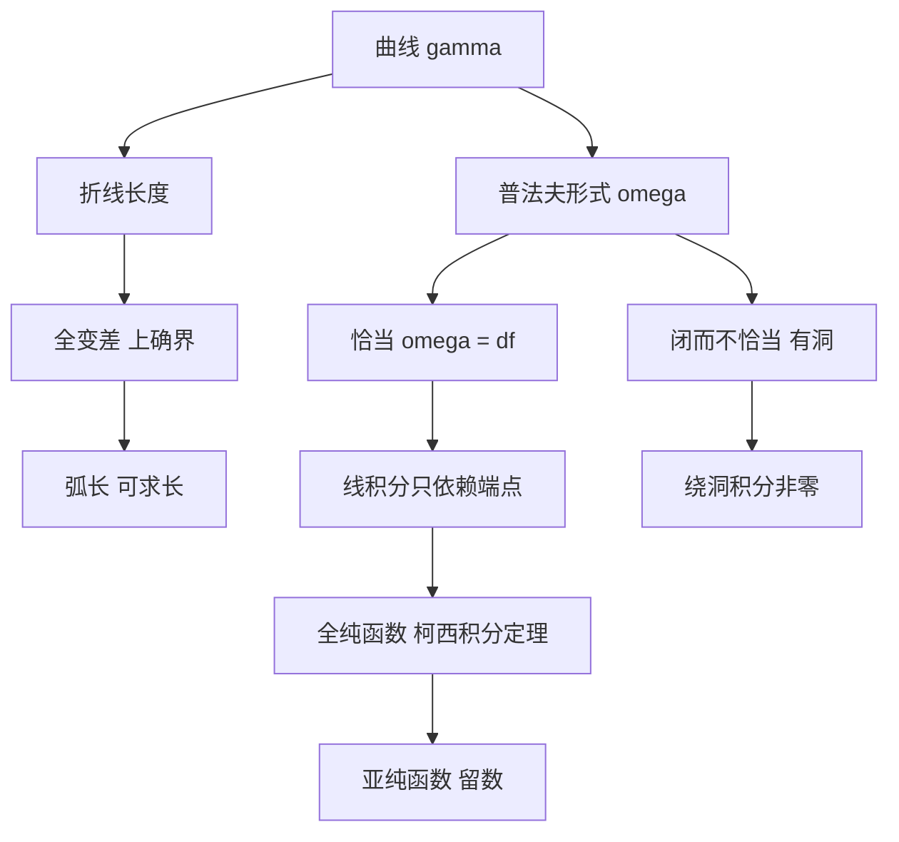

# 第 8 章：线积分

- **难度**：★★★ ｜ **预估学时**：12 小时 ｜ **前置**：第 6 章（积分）、第 7 章（多变量微分）

> 原书对弧长的处理很实在：把连续路径 γ 的"全变差"直接定义为它的长度；只要变差有限，路径就称为可求长的。长度不是先验概念，是一族折线长度的上确界。

## 学习目标

学完本章，你能：
1. 用分割的折线长度定义全变差，判断路径是否可求长，并写出弧长公式。
2. 解释普法夫形式与恰当形式，判断一个 1-形式是否恰当。
3. 计算线积分，判断积分是否与路径无关，并求出势函数。
4. 说明全纯函数的柯西–黎曼方程，以及亚纯函数的极点与留数。

## 一句话核心

线积分把 1-形式沿曲线"累加"；当形式恰当（等于某个函数的微分）时，累加结果只取决于端点，这条性质把微积分基本定理推广到了曲线上。

## 零基础讲解

### 概念 1：曲线的长度 = 折线长度的上确界

设 γ : [a, b] → E 连续，分割 Z = (t₀, …, tₙ)。折线长度

L_Z(γ) := Σ ‖γ(tⱼ) − γ(tⱼ₋₁)‖。

全变差 Var(γ, [a,b]) := sup_Z L_Z(γ)。若有限，称 γ 可求长，并把这个值定义为弧长 L(γ)。

两条基本事实：

- 变差可加：Var(γ, [a,b]) = Var(γ, [a,c]) + Var(γ, [c,b])。
- 利普希茨路径可求长，且 L(γ) ≤ λ(b − a)，λ 是利普希茨常数。

反面例子：γ(t) = t cos²(π/2t)（t > 0），γ(0) = 0。取合适分割，折线长度是调和级数的部分和，趋于无穷，所以这个连续路径不可求长。这说明"连续"远不足以保证有限长度。

若 γ 是 C¹，则 L(γ) = ∫_a^b ‖γ′(t)‖ dt。这是把折线长度的上确界算成积分。

**类比**：路径是走过的轨迹，全变差是计步器读数。无论你怎么细分采样点，读数的上确界就是真实路程；来回踱步的路径读数会很大。

### 概念 2：普法夫形式

在 ℝⁿ 的开集上，1-形式（普法夫形式）写成

ω = Σ aⱼ(x) dxⱼ，

其中 aⱼ 是光滑函数。它不是"无穷小量"，而是一个把切向量喂进去就输出数值的规则：给定一点和方向 v，输出 Σ aⱼ(x) vⱼ。

ω **恰当**，如果存在函数 f 使 ω = df，即 aⱼ = ∂f/∂xⱼ。此时 f 叫势函数。

判断恰当性的一维必要条件是**闭性**：∂aⱼ/∂xₖ = ∂aₖ/∂xⱼ（混合偏导相等）。在单连通区域上，闭 ⇒ 恰当（庞加莱引理）；有洞的区域不成立，经典例子是

ω = (x dy − y dx)/(x² + y²)，

它在 ℝ² 去掉原点后闭但不恰当，因为绕原点一圈积分是 2π 而不是 0。

**类比**：恰当形式像"保守力场"：重力、静电力做功只与起点终点有关。闭而不恰当像绕着一个洞转圈，每转一圈都"捡到"一点能量。

### 概念 3：线积分的定义与计算

沿 C¹ 曲线 γ : [a,b] → ℝⁿ 积分：

∫_γ ω := ∫_a^b Σ aⱼ(γ(t)) γⱼ′(t) dt。

它是普通定积分的复合：把形式在曲线上的取值对参数积分。结果与参数化无关（只差方向符号）：换参数 s = φ(t) 时，链式法则把 γ′dt 换成 γ′ds，积分值不变。

基本定理的推广：若 ω = df，则 ∫_γ ω = f(γ(b)) − f(γ(a))。路径无关性由此而来。

计算实例：ω = x dy − y dx，γ 为单位圆 t ↦ (cos t, sin t)，t ∈ [0, 2π]。
∫_γ ω = ∫₀^{2π} (cos t · cos t − sin t · (−sin t)) dt = ∫₀^{2π} 1 dt = 2π。
这个值等于圆面积，也等于绕原点一圈的"角增量"，说明 ω 不是恰当的。

### 概念 4：全纯函数

f : U ⊆ ℂ → ℂ 全纯：在每点复可微，即

f′(z) = lim_{h→0} (f(z + h) − f(z))/h

存在（h 沿复平面任意方向）。这比实可微强得多：它要求两个实偏导满足柯西–黎曼方程

∂u/∂x = ∂v/∂y，∂u/∂y = −∂v/∂x（f = u + iv）。

等价说法：f 的微分 f′(z) dz 是 ℂ 值 1-形式，且满足某种闭性；全纯函数的实部与虚部都是调和函数。

关键结论：

- 全纯 ⇒ 解析：每点附近可展开成幂级数。
- 柯西积分定理：在单连通区域内全纯的函数，沿任意闭曲线的积分为 0。
- 柯西积分公式：f(a) = (1/2πi) ∮ f(z)/(z − a) dz。
- 刘维尔定理：有界的整函数必为常数。

**类比**：实可微像"从东西南北四个方向看都平滑"，全纯像"从所有方向看都平滑且旋转角度一致"。后者约束更强，所以全纯函数有刚性：一点的信息决定一片区域。

### 概念 5：亚纯函数与留数

亚纯：在区域内除孤立极点外全纯。

若 f 在 a 处有 m 阶极点，则 f(z) = c_{−m}/(z−a)ᵐ + … + c_{−1}/(z−a) + 全纯部分。c_{−1} 叫留数 Res(f, a)。

留数定理：∮_γ f dz = 2πi Σ Res(f, aₖ)（aₖ 在 γ 内部）。

计算实例：∮_{|z|=1} dz/z = 2πi，因为留数为 1。这个例子说明"闭形式在洞里积分不为 0"，与普法夫形式的洞是同一件事。

## 图示

**看图说明**：左支是几何（长度），右支是微分形式（积分）。两支在"绕洞积分非零"处汇合：这正是柯西积分定理与留数定理的几何来源。

## 类比与实例

**类比**：线积分像沿路线记录"每走一步，计费器按当前位置的单价跳多少"。若单价来自某个"高度函数"（恰当形式），总费用只与起点终点有关；若单价绕着一个柱子打转（闭而不恰当），绕一圈就多收一笔。
**失效边界**：只有区域没有洞时，"闭 ⇒ 恰当"才成立；有洞时绕洞一圈的积分是拓扑量，不能靠局部条件消掉。

**实例（可验证）**：验证 ω = y dx + x dy 恰当，并求势函数。
∂(y)/∂y = 1，∂(x)/∂x = 1，满足闭性；在 ℝ²（单连通）上恰当。取 f(x,y) = xy，则 df = y dx + x dy。沿任意曲线从 (0,0) 到 (1,2)，积分都是 2，与路径无关。

## 常见误解

- **别以为"连续曲线一定有长度"** — 实际上存在连续但不可求长的路径（t cos²(π/2t)）。
- **别以为"闭形式一定恰当"** — 实际上只在单连通区域成立；(x dy − y dx)/(x²+y²) 是标准反例。
- **别以为"线积分只依赖端点"总是成立** — 实际上只有恰当形式才路径无关；否则绕一圈的积分可能非零。
- **别以为"实可微就是全纯"** — 实际上全纯还要求柯西–黎曼方程，条件强得多。

## 自测题（答案）

1. 关于全变差，正确的说法是？　A. 连续曲线的全变差总有限　B. 全变差是折线长度的上确界　C. 全变差等于端点距离　D. 全变差只对直线有限
   **答案**：B。**解析**：定义就是 sup 折线长度。连续曲线可以不可求长（t cos²(π/2t)），端点距离只是下界。

2. ω = (x dy − y dx)/(x² + y²) 在 ℝ² 去掉原点后？　A. 恰当　B. 闭但不恰当　C. 既不闭也不恰当　D. 恒为 0
   **答案**：B。**解析**：混合偏导相等故闭；但绕单位圆积分 2π ≠ 0，所以不存在单值势函数，不恰当。

3. ∮_{|z|=1} dz/z 的值是？　A. 0　B. 2πi　C. πi　D. 1
   **答案**：B。**解析**：1/z 在 0 处留数为 1，由留数定理积分等于 2πi·1。

## 复习锚点

- 弧长 = 折线长度的上确界；利普希茨是充分条件，连续不够。
- 恰当 ⇔ 有势函数；单连通区域上闭 ⇒ 恰当。
- 全纯 = 复可微 = 柯西–黎曼；留数定理把闭路积分变成极点处的系数。
