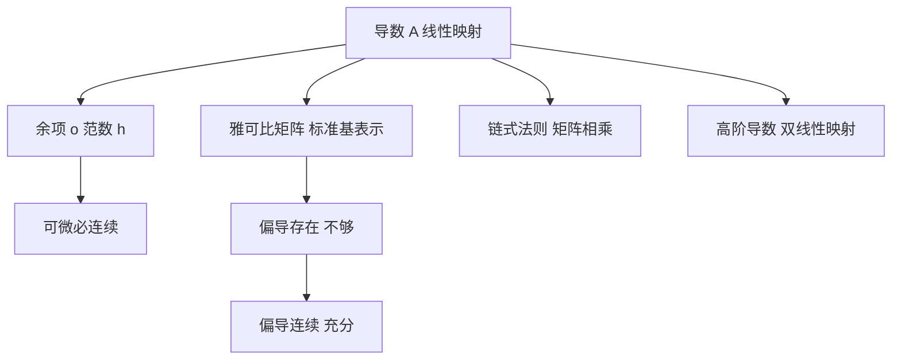

# 弗雷歇微分与雅可比矩阵

- **难度**：高难 ｜ **涉及章节**：第 7 章（§2–§5）

## 一句话定义

多变量函数在一点的导数是一个线性映射 A，使得 f(a + h) = f(a) + Ah + o(‖h‖)；雅可比矩阵是 A 在标准基下的表示。

## 为什么重要

它是所有多变量结论的入口：链式法则、逆映射、隐函数、流形、变分法，全部建立在"导数 = 线性映射"之上。把导数当成一堆偏导数的表格，会导致"偏导存在就可微"这类错误。

## 图示

## 详解

定义：存在 A ∈ L(E, F)，使

lim_{h→0} ‖f(a+h) − f(a) − Ah‖ / ‖h‖ = 0。

唯一性：若有两个这样的 A，相减得 ‖(A₁ − A₂)h‖/‖h‖ → 0，由线性性只能 A₁ = A₂。

与偏导的关系：若可微，则 ∂fᵢ/∂xⱼ = A 的矩阵元。反之不成立——偏导只描述沿坐标轴的行为，可微要求所有方向的误差统一为 o(‖h‖)。

反例 f(x,y) = xy/(x²+y²)：沿坐标轴恒为 0，故两个偏导为 0；沿 y = x 值为 1/2，不连续。A 不可能存在。

充分条件：若所有偏导在 a 的邻域存在且在 a 连续（C¹），则可微。证明用"沿坐标轴逐段走"把 f(a+h) − f(a) 写成偏导的积分，再用连续性控制。

链式法则：(f∘g)′(a) = f′(g(a))g′(a)，矩阵形式就是雅可比相乘。注意顺序不能反。

高阶导数：D²f(a) 是双线性映射，矩阵为 Hessian。C² 时对称（施瓦茨定理），这给泰勒公式的二阶项提供了良好定义。

## 常见误解

- 别以为偏导存在就可微——需要统一的线性逼近。
- 别以为雅可比矩阵就是导数——换基会换矩阵，映射本身不变。
- 别以为"各方向方向导数都存在"就够——方向导数存在也不保证可微，反例需要更精细的构造。

## 在书中出现的脉络

| 章节 | 语境 | 关键结论 |
|---|---|---|
| 第 7 章 §1 | 连续线性映射 | 算子范数、L(E,F) 完备 |
| 第 7 章 §2 | 可微性 | 弗雷歇导数定义 |
| 第 7 章 §3 | 微分法则 | 链式、乘积、商 |
| 第 7 章 §5 | 高阶导数 | 对称性、泰勒 |
| 第 12 章 §1 | 体积测度 | 雅可比行列式进入换元公式 |

## 相关概念

- 前置：一元导数、算子范数
- 后续：逆映射定理、隐函数定理、微分形式
