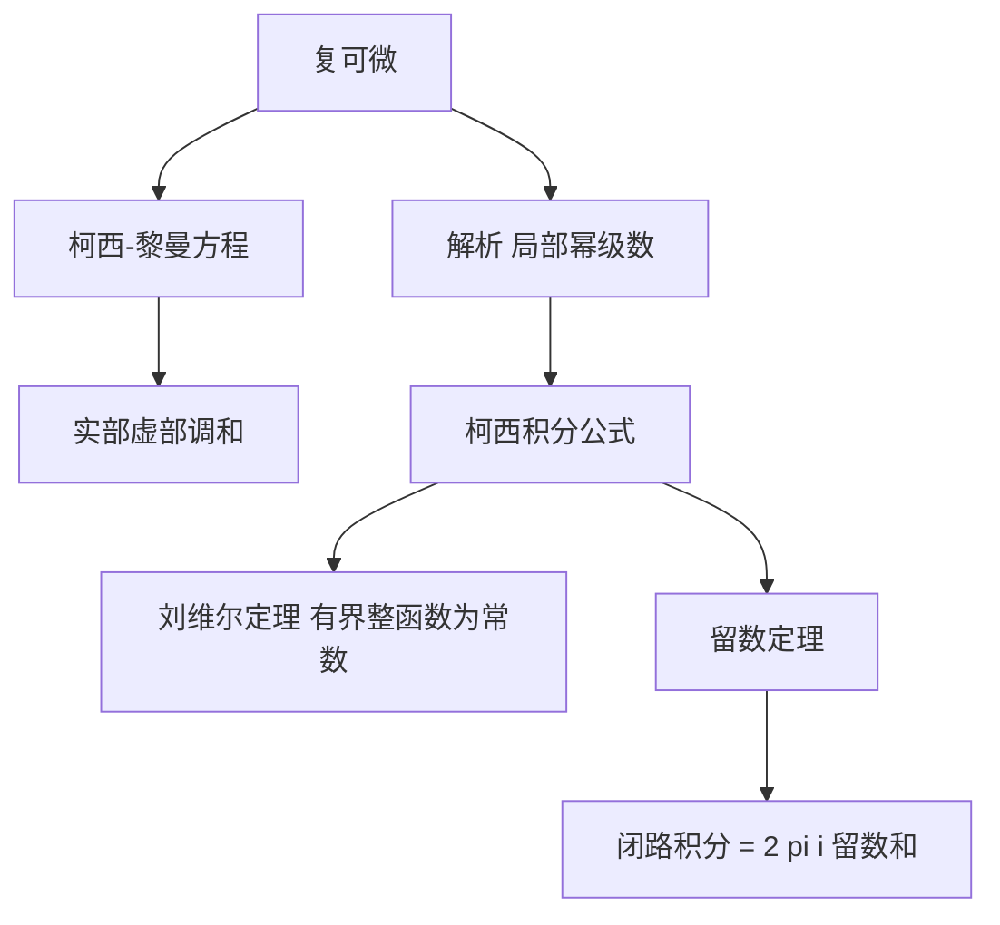

# 全纯函数

- **难度**：高难 ｜ **涉及章节**：第 8 章（§5–§6）

## 一句话定义

复平面上在每点复可微的函数，等价于实部与虚部满足柯西–黎曼方程，并且局部可以展开成幂级数。

## 为什么重要

它是复分析的入口，也是本卷最"刚性"的对象：一点的全部导数决定整个连通区域。柯西积分定理与留数定理把复杂的闭路积分变成极点上几个系数的和，这种效率在实分析里没有对应物。

## 图示

## 详解

复可微：极限 lim_{h→0}(f(z+h) − f(z))/h 存在，h 可从任意方向趋于 0。这比实可微强得多：把 h 分别取实数方向和虚数方向，得到两个偏导关系

u_x = v_y，u_y = −v_x。

这就是柯西–黎曼方程。它保证 f 的微分是"复线性"的，而不是一般的实线性映射。

主要结论：

- 全纯 ⇒ 解析：在每点附近 f(z) = Σ cₙ(z − a)ⁿ，收敛半径由奇点位置决定。
- 柯西积分定理：单连通区域内全纯函数沿闭曲线积分为 0。
- 柯西积分公式：f(a) = (1/2πi)∮ f(z)/(z − a) dz，由此可得各阶导数公式。
- 刘维尔：有界整函数是常数，于是代数学基本定理可以用它证明。
- 留数定理：∮ f dz = 2πiΣ Res(f, aₖ)。

**类比**：全纯函数像一块没有内应力的玻璃，局部形状决定整体；实可微函数像橡皮泥，可以任意揉捏。
**边界**：全纯只在一个开区域内讨论；边界上的奇点（如 1/z 在 0）正是留数信息的来源。

## 常见误解

- 别以为"实部虚部都可微"就是全纯——还必须满足柯西–黎曼方程。
- 别以为全纯函数的积分总能算成 0——区域有洞时闭路积分可以非零（∮dz/z = 2πi）。
- 别以为解析展开只在一点成立——收敛圆内成立，圆外要换展开点。

## 在书中出现的脉络

| 章节 | 语境 | 关键结论 |
|---|---|---|
| 第 8 章 §5 | 全纯函数 | 柯西–黎曼、柯西积分定理 |
| 第 8 章 §6 | 亚纯函数 | 极点、留数、留数定理 |
| 第 10 章 §9 | 傅里叶变换 | 解析方法与傅里叶变换的联系 |

## 相关概念

- 前置：线积分、普法夫形式、幂级数
- 后续：留数定理、傅里叶变换、解析延拓
