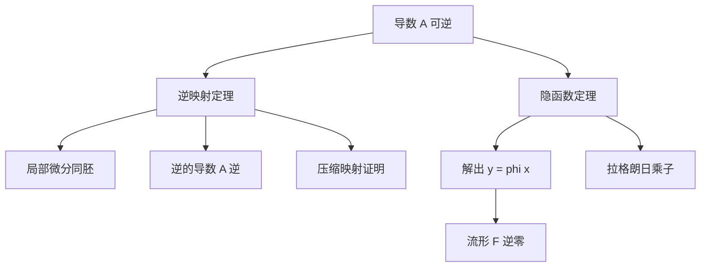

# 逆映射定理与隐函数定理

- **难度**：高难 ｜ **涉及章节**：第 7 章（§7–§9）

## 一句话定义

若 f 在 a 处的导数是可逆线性映射，则 f 在 a 附近可逆且逆映射光滑；隐函数定理是它在"解方程"问题上的变形。

## 为什么重要

它们是把非线性问题局部线性化的许可证。数值求解、流形定义、约束优化、微分方程解的存在性，都要先验证"该点导数可逆"这个条件。

## 图示

## 详解

**逆映射定理**：f : U → F 是 C¹，f′(a) 是拓扑同构，则存在 a 的邻域 V 与 f(a) 的邻域 W，使 f|V : V → W 是双射且逆映射 C¹，并且

(f⁻¹)′(f(a)) = (f′(a))⁻¹。

证明骨架：把 f(x) = y 改写为 x = T(x)，T(x) = x − A⁻¹(f(x) − y)，A = f′(a)。在 a 附近 T 是压缩（因为 T′ = I − A⁻¹f′(x)，在 a 处为 0，连续性与可逆性保证范数 < 1），由压缩映射原理得唯一不动点，再用参数连续性得 C¹。

**隐函数定理**：F : U × V → G 是 C¹，F(a, b) = 0，∂F/∂y(a, b) 可逆，则存在唯一的 C¹ 函数 φ，φ(a) = b，F(x, φ(x)) = 0，且

φ′(x) = −(∂F/∂y)⁻¹ ∂F/∂x。

两者本质相同：把 F(x, y) = 0 看成 f(y) = 0 的参数化版本，对 y 用逆映射定理。

**流形**：若 DF(p) 满秩，则 F⁻¹(0) 在 p 附近是 n − k 维流形，切空间为 ker DF(p)。这把"方程的解集"变成了有切空间的几何对象。

**约束极值**：在 g(x) = 0 上求 f 的极值，若 ∇g ≠ 0，则 ∇f = λ∇g。几何上是两个等值面在极值点相切。λ 是约束的影子价格。

## 常见误解

- 别以为"导数可逆"可以换成"函数单射"——单射不保证局部可逆（如 x ↦ x³ 在 0 处单射但导数为 0）。
- 别以为隐函数定理给的是全局解——只在 a 的某个邻域内成立。
- 别以为条件只是技术性的——在 ∂F/∂y = 0 处，解可能分裂成多支（圆的左右端点）。

## 在书中出现的脉络

| 章节 | 语境 | 关键结论 |
|---|---|---|
| 第 7 章 §7 | 逆映射 | 局部微分同胚、逆的导数 |
| 第 7 章 §8 | 隐函数 | 解出 y = φ(x)、导数公式 |
| 第 7 章 §9 | 流形 | 隐式定义的子流形与切空间 |
| 第 11 章 §1 | 子流形 | 浸入、嵌入、带边流形 |

## 相关概念

- 前置：弗雷歇导数、压缩映射原理
- 后续：子流形、拉格朗日乘子、微分形式
