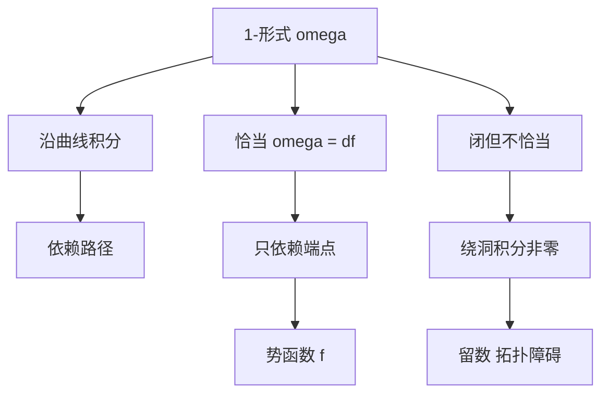

# 线积分与势函数

- **难度**：进阶 ｜ **涉及章节**：第 8 章（§1–§4）、第 11 章（§3）

## 一句话定义

线积分是把 1-形式沿曲线累加；若该形式等于某个函数的微分（恰当形式），累加结果只依赖起点与终点，那个函数就是势函数。

## 为什么重要

它把微积分基本定理推广到曲线上，也是"保守力场"的数学版本。第 11 章的微分形式、第 12 章的斯托克斯定理，都是它向高维的推广。

## 图示

## 详解

定义：ω = Σ aⱼ dxⱼ 沿 C¹ 曲线 γ 的积分为 ∫_a^b Σ aⱼ(γ(t))γⱼ′(t) dt。

三个层次：

1. **计算**：把形式在曲线上的取值对参数积分，换参数不变（方向反转变号）。
2. **恰当性**：若 ω = df，则 ∫_γ ω = f(γ(b)) − f(γ(a))。于一维就是牛顿–莱布尼茨公式。
3. **判据**：∂aⱼ/∂xₖ = ∂aₖ/∂xⱼ（闭性）是必要条件；在单连通区域上也是充分的（庞加莱引理）。

反例：ω = (x dy − y dx)/(x² + y²) 在 ℝ² ∖ {0} 上闭，但绕单位圆积分为 2π ≠ 0，故不恰当。这个 2π 是拓扑量，正是复分析里留数定理的来源。

势函数的求法：沿坐标轴分段积分，或解梯度方程组 ∂f/∂xⱼ = aⱼ，再用闭性保证可积。

**类比**：恰当形式像"海拔差"，只与起点终点有关；闭而不恰当像"绕塔转圈"，每转一圈都累积一个固定角度。
**边界**：只有区域单连通时"闭 ⇒ 恰当"；有洞时拓扑障碍无法靠局部条件消除。

## 常见误解

- 别以为线积分总与路径无关——只有恰当形式才如此。
- 别以为"闭形式"就是"恰当形式"——有洞区域是反例。
- 别以为势函数一定存在且唯一——差一个常数仍成立，有洞时可能多值（角度函数）。

## 在书中出现的脉络

| 章节 | 语境 | 关键结论 |
|---|---|---|
| 第 8 章 §1 | 曲线与长度 | 全变差、可求长、弧长公式 |
| 第 8 章 §3 | 普法夫形式 | 恰当形式、势函数 |
| 第 8 章 §4 | 线积分 | 定义、路径无关、基本定理 |
| 第 11 章 §3 | 微分形式的局部理论 | 外微分、闭与恰当 |
| 第 12 章 §3 | 斯托克斯定理 | 高维推广 |

## 相关概念

- 前置：黎曼积分、偏导数
- 后续：全纯函数、微分形式、斯托克斯定理
