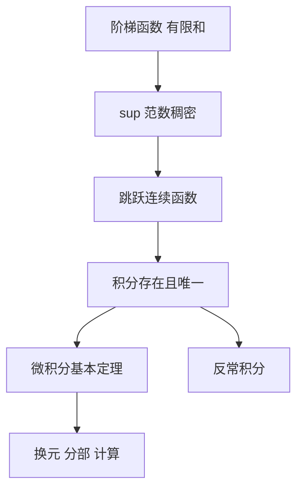

# 黎曼积分

- **难度**：进阶 ｜ **涉及章节**：第 6 章（§1–§5）、第 10 章（§5）

## 一句话定义

把一个函数用阶梯函数一致逼近，取这些阶梯函数积分值的极限，这个极限就是黎曼积分。

## 为什么重要

它把"面积"从几何直觉变成可证明的对象，并且给出可积的判据。第 10 章的勒贝格积分是它的推广：把"阶梯函数"换成"简单函数"，把"一致逼近"换成"几乎处处逼近"，从而能处理更病态的函数与极限交换。

## 图示

## 详解

阶梯函数 f = Σ cⱼ χ_(αⱼ₋₁, αⱼ) 的积分定义为 Σ cⱼ(αⱼ − αⱼ₋₁)。

关键估计：|∫f| ≤ ‖f‖∞(β − α)。这条估计说明积分映射是利普希茨的，因此可以把定义从阶梯函数唯一延拓到其一致闭包——即跳跃连续函数。跳跃连续指每点左右极限存在；连续函数、分段连续函数都属此类。

可积的实用判据：对每个 ε > 0，存在阶梯函数 φ，使 sup|f − φ| < ε。

可积函数不必连续：符号函数在 [−1,1] 上跳跃连续，积分存在。但 Dirichlet 函数（有理点取 1、无理点取 0）不黎曼可积，因为它与任何阶梯函数的 sup 距离都是 1。

勒贝格积分的思想差别：不要求"处处逼近"，只要求"除了一个零测集之外逼近"。代价是要先建测度论（第 9 章）。

## 常见误解

- 别以为积分就是面积——对变号函数面积要带符号，对向量值函数没有面积可言。
- 别以为连续是必要的——跳跃连续即可，黎曼可积类还更宽。
- 别以为"几乎处处连续"就黎曼可积——有界 + 间断点集测度为零才是黎曼可积的完整刻画（勒贝格判据）。

## 在书中出现的脉络

| 章节 | 语境 | 关键结论 |
|---|---|---|
| 第 6 章 §1 | 阶梯函数 | 有限和的定义 |
| 第 6 章 §3 | 柯西–黎曼积分 | 延拓与唯一性 |
| 第 6 章 §4 | 性质 | 线性、单调、估计 |
| 第 10 章 §5 | 勒贝格积分 | 黎曼积分是绝对可积情形的推广 |

## 相关概念

- 前置：一致收敛、连续、紧致
- 后续：反常积分、L¹ 空间、勒贝格积分
