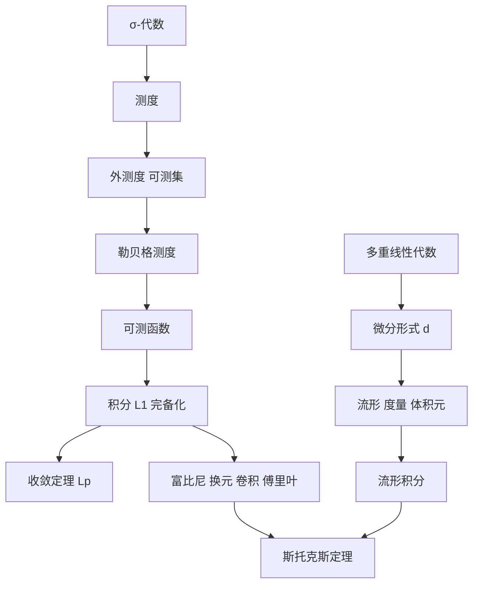

# 《分析 III》点化学习系统

## 这本书在讲什么

第三卷把分析从"平坦空间"搬到"弯曲空间"。先用卡拉泰奥多里的外测度路线建立测度与积分，得到勒贝格理论与三大收敛定理；再用多重线性代数造出微分形式，用外微分把"闭/恰当"变成代数条件；最后在流形上用体积元积分 m-形式，以斯托克斯定理收束全书。

## 全书心智模型

## 学习路径（推荐顺序）

| 步骤 | 章节 | 主题 | 前置 | 检查点 |
|---|---|---|---|---|
| 09 | ch09 | σ-代数、测度、外测度 | 分析 I 第 2–3 章 | ch09 自测三题 |
| 10 | ch10 | 可测函数、积分、收敛定理 | ch09 | ch10 自测三题 |
| 11 | ch11 | 流形、形式、度量 | 分析 II 第 7–8 章 | ch11 自测三题 |
| 12 | ch12 | 体积元、形式积分、斯托克斯 | ch09–ch11 | ch12 自测三题 |

## 章节索引

- 第 9 章 测度论基础（难度 ★★★）→ chapters/ch09-measure.md
- 第 10 章 积分理论（难度 ★★★）→ chapters/ch10-integration-theory.md
- 第 11 章 流形与微分形式（难度 ★★★）→ chapters/ch11-manifolds-forms.md
- 第 12 章 流形上的积分（难度 ★★★）→ chapters/ch12-manifold-integration.md

## 前置知识（零基础缺口补讲）

| 缺口 | 对应补讲位置 | 学完标志 |
|---|---|---|
| 没接触过测度 | ch09 概念 1、概念 2 | 能写出 σ-代数三条公理 |
| 不理解"几乎处处" | ch10 概念 1 | 能解释零测集为何不影响积分 |
| 不熟悉多重线性代数 | ch11 概念 2 | 能算 dx∧dy 在两组向量上的值 |
| 不会算曲面面积 | ch12 概念 2 | 能独立算出球面面积 |

## 术语表 / 模式库 / 速查表 入口

- 术语：glossary.md
- 模式：patterns.md
- 速查：cheatsheet.md
