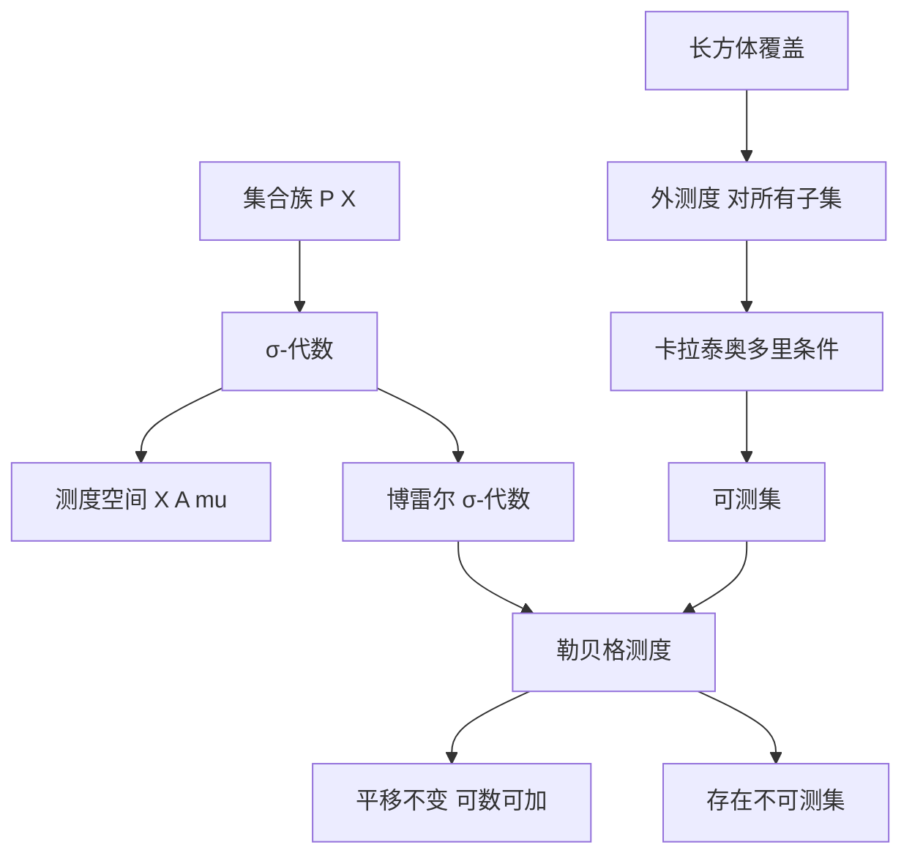

# 第 9 章：测度论基础

- **难度**：★★★ ｜ **预估学时**：12 小时 ｜ **前置**：第 2 章（完备性）、第 3 章（拓扑）、第 6 章（Riemann 积分）

> 原书开宗明义：这一章讨论直线、面积、体积以及更高维空间中集合的测度的一般理论，而该理论以初等几何事实为指导——区间有长度，矩形有长乘宽，长方体有长宽高。

## 学习目标

学完本章，你能：
1. 写出 σ-代数的三条公理，并说明为什么测度的定义域必须是 σ-代数。
2. 用外测度 + 卡拉泰奥多里条件定义可测集，解释这条条件在防什么。
3. 说明勒贝格测度为什么不能给 ℝⁿ 的每个子集赋值（不可测集的存在）。

## 一句话核心

测度是"给集合赋大小"的函数，但它的定义域不能是全部子集，必须是一个对可数并、补集封闭的族（σ-代数）；勒贝格测度的构造路线是"先定义外测度，再用卡拉泰奥多里条件筛出可测集"。

## 零基础讲解

### 概念 1：为什么需要 σ-代数

要给 ℝ 的子集赋"长度"，最自然的要求是：

- 区间的长度是 b − a；
- 不交并的长度可加（可数多个也允许）；
- 平移不改变长度。

如果对所有子集都能赋值，就会和"选择公理 + 可数可加"冲突——维塔利构造出的集合，无论赋什么值都会矛盾。所以必须限制定义域。

σ-代数 A ⊆ P(X) 满足：

1. X ∈ A；
2. A ∈ A ⇒ Aᶜ ∈ A；
3. 可数并 ∪Aⱼ ∈ A。

由德摩根律，可数交也封闭。测度 μ : A → [0, ∞] 再满足 μ(∅) = 0 与可数可加性：不交的 Aⱼ 满足 μ(∪Aⱼ) = Σμ(Aⱼ)。

**类比**：σ-代数是一张"允许测量的清单"。不在清单上的集合，不是"大小为 0"，而是"没有定义"。**边界**：清单必须对补集和可数并封闭，否则"两个可测集相减"会跑出清单。

### 概念 2：博雷尔 σ-代数

给定拓扑空间 X，包含所有开集的最小 σ-代数叫博雷尔 σ-代数 B(X)。它包含开集、闭集、可数交并、以及所有通过极限操作得到的集合。

为什么需要它？因为连续函数、极限、开集这些概念都是拓扑的，而"可测"要与它们兼容。勒贝格可测集比博雷尔多：它是博雷尔 σ-代数加上所有零测集的子集（完备化）。

### 概念 3：外测度

外测度 μ* : P(X) → [0, ∞] 对**所有**子集都有定义，满足单调性与可数次可加性：

μ*(∪Aⱼ) ≤ Σμ*(Aⱼ)。

ℝⁿ 上的勒贝格外测度定义为

λ*(A) := inf{Σ vol(Qⱼ) : A ⊆ ∪Qⱼ}，

其中 Qⱼ 是开长方体。也就是"用可数多个长方体盖住 A，取总体积的下确界"。

外测度对每个集合都有值，但一般不满足可加性：两个不交集合的外测度之和可能小于并的外测度（因为覆盖可以"跨接"）。

**类比**：外测度像"用最小的包装纸把东西包起来"，包装纸可以重叠、可以包到空气。它对任何东西都能量，但两个东西分开包和一起包，包装纸用量可能不同。

### 概念 4：卡拉泰奥多里可测条件

A 可测，如果对**每个**测试集 T，

μ*(T) = μ*(T ∩ A) + μ*(T ∩ Aᶜ)。

这条条件的直觉是：A 必须像一把"干净刀"，无论怎么切 T，两块的测度之和都等于原来的测度。它排除了那些"边界模糊、切开后总量会变"的集合。

由外测度构造的 μ* 限制在可测集上就是一个测度，记作 μ。这是卡拉泰奥多里给出的构造定理，也是本书第 3、4 节的主线。

**类比**：A 可测就像一把好刀切蛋糕：不管蛋糕多大、形状多怪，切下去两块的重量之和等于原来那块。刀不利（不可测集），切的过程中会掉渣。

### 概念 5：勒贝格测度

在 ℝⁿ 上，用长方体覆盖定义外测度，再取可测集，得到勒贝格测度 λₙ。它的性质：

- 平移、旋转不变；
- 开集的测度可以算，闭集也可以；
- 单点、可数集测度为 0；
- 康托集测度为 0，但不可数；
- 存在不可测集（维塔利，用选择公理把 [0,1] 分成可数多份等测度的类）。

**康托集的警示**：它和区间等势（不可数），测度却是 0。"大小"和"元素多少"是两套独立的度量。

**类比**：勒贝格测度像"称重量"。一根细粉笔和一块海绵可以一样重，体积、元素个数都不能决定重量。

### 概念 6：豪斯多夫测度与维数（延伸）

用直径 ≤ δ 的可数覆盖定义 h^s_δ(A)，取 δ → 0 得 s 维豪斯多夫测度。使测度从 ∞ 跳到 0 的临界 s 叫豪斯多夫维数。康托集的维数是 log2/log3 ≈ 0.63，介于点和线之间。这部分在书中作为测度构造的例子出现，提示"维数"本身可以被测度定义。

## 图示

**看图说明**：上面一条是"公理化路线"（先定 σ-代数与测度），下面一条是"构造路线"（先外测度再筛可测集）。两条在勒贝格测度处汇合，这是本书的叙事结构，也是做测度题的标准路径：先用覆盖算外测度，再验卡拉泰奥多里条件。

## 类比与实例

**类比**：测度像给房间估面积。可以精确量的房间（可测集）满足"怎么切都守恒"；有些房间（不可测集）无论怎么估都会和切割结果矛盾，只能承认"没有面积"。
**失效边界**：测度不是万能的——"每个集合都有面积"这个直觉是错的；选择公理下不可测集必然存在。

**实例（可验证）**：证明单点集测度为 0。
对任意 ε > 0，用长度 ε 的区间盖住 {x}，外测度 ≤ ε。因 ε 任意，外测度 = 0。又 ∅ 可测，单点 = 区间 ∩ 补集之类可测，故测度为 0。
这个论证展示了"外测度 → 下确界 → 任意 ε"的标准套路。

## 常见误解

- **别以为"所有集合都可测"** — 实际上维塔利定理给出不可测集，前提是接受选择公理。测度论的公理化就是为了绕开这个矛盾。
- **别以为"测度为 0 就是空集或有限集"** — 实际上康托集不可数、测度为 0。
- **别以为外测度就是测度** — 实际上外测度只次可加，不满足可加；只有限制在可测集上才成为测度。
- **别以为"可测"是集合自身的性质** — 实际上它相对于给定的外测度（也就是给定的测度空间）而言。

## 自测题（答案）

1. σ-代数不需要满足下列哪条？　A. 包含全集　B. 对补集封闭　C. 对可数并封闭　D. 对任意并封闭
   **答案**：D。**解析**：σ-代数只要求可数并封闭；任意并会超出可数可加性的框架，也不需要。

2. 卡拉泰奥多里条件的作用是？　A. 定义外测度　B. 筛选出可测集　C. 证明选择公理　D. 计算体积
   **答案**：B。**解析**：条件 μ*(T) = μ*(T∩A) + μ*(T∩Aᶜ) 对所有 T 成立时，称 A 可测；这是从外测度得到测度的筛子。

3. 康托集的性质是？　A. 可数且测度为 0　B. 不可数且测度为 0　C. 不可数且测度为正　D. 可数且测度为正
   **答案**：B。**解析**：康托集与 [0,1] 等势（不可数），但总长度（测度）为 0。这说明"元素多少"与"测度大小"是两回事。

## 复习锚点

- σ-代数 = 允许测量的集合清单，对补集与可数并封闭。
- 外测度对所有子集有定义，但只次可加；可测性用卡拉泰奥多里条件筛。
- 勒贝格测度：平移不变、可数可加；不可测集存在，康托集测度为 0。
