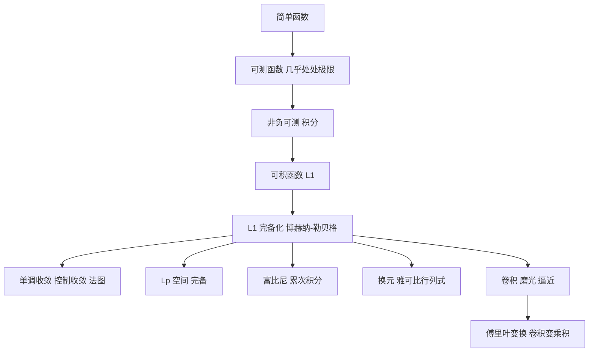

# 第 10 章：积分理论

- **难度**：★★★ ｜ **预估学时**：16 小时 ｜ **前置**：第 9 章（测度）、第 6 章（Riemann 积分）、第 2 章（完备性）

> 原书把构造路线说得很直接：先引入一般测度空间上的积分，用简单函数空间的 L¹-完备化来实现；这样既能处理向量值函数（博赫纳–勒贝格积分），又为收敛定理的证明打好地基。

## 学习目标

学完本章，你能：
1. 用简单函数逼近定义 μ-可测函数，说明"几乎处处"在证明中怎么用。
2. 说出单调收敛定理与控制收敛定理的条件，并用它们交换极限与积分。
3. 证明 Lp 空间完备，区分"函数"与"等价类"。
4. 写出富比尼定理、换元公式与傅里叶变换的基本性质。

## 一句话核心

勒贝格积分不是"更复杂的面积"，而是"用简单函数在几乎处处意义下逼近，再把 L¹ 补齐成完备空间"；一旦完备，极限与积分就能在很宽的条件下交换，这是它比黎曼积分强的地方。

## 零基础讲解

### 概念 1：可测函数

设 (X, A, μ) 是测度空间。简单函数是有限个特征函数的线性组合：

f = Σ eⱼ χ_{Aⱼ}，μ(Aⱼ) < ∞。

它只取有限多个值，每个值的原像可测。可测函数是简单函数列的几乎处处极限：存在简单函数 fⱼ，使 fⱼ → f 在 μ-几乎处处意义下成立，即除去一个零测集之外处处收敛。

"几乎处处"不是偷懒，它是勒贝格理论的语法。零测集上的行为不影响积分，也不影响大多数定理。代价是结论都带"a.e."（almost everywhere，几乎处处）。

**类比**：可测函数像"允许有污点的扫描件"：只要污点面积为零（有限个像素、可数条线），内容就算清晰可读。
**边界**：如果污点是一整片（正测度），就不行；零测集必须真的是"面积为 0"。

### 概念 2：积分怎么定义

三步走：

1. 简单函数 f = Σ eⱼ χ_{Aⱼ} 的积分定义为 Σ eⱼ μ(Aⱼ)。
2. 非负可测函数 f：取简单函数列 0 ≤ fⱼ ↑ f，定义 ∫f := lim ∫fⱼ（这个极限与逼近列的选择无关，由单调收敛定理保证）。
3. 一般可测函数：拆成正部与负部，f = f⁺ − f⁻，若两部分的积分都有限，则称 f 可积（L¹），定义 ∫f = ∫f⁺ − ∫f⁻。

向量值函数（取值在巴拿赫空间）：用"简单函数空间在 L¹ 范数下的完备化"来定义。这一步用到了第 2 章的完备化思想：先定义简单函数上的积分，再取 L¹ 范数 ‖f‖₁ := ∫‖f‖，完备化后得到的空间就是 L¹(X, μ, E)，积分延拓为连续线性泛函。

**类比**：先用乐高小块拼出形状（简单函数），再取"误差面积趋于 0"的极限。完备化保证极限不会跑出空间。

### 概念 3：三大收敛定理

- **单调收敛**：0 ≤ fₙ ↑ f a.e.，则 ∫fₙ ↑ ∫f。允许积分值为 ∞。
- **法图引理**：∫liminf fₙ ≤ liminf ∫fₙ（非负可测）。它是单调收敛与控制收敛之间的桥梁。
- **控制收敛**：fₙ → f a.e.，且存在可积的 g 使 |fₙ| ≤ g a.e.，则 ∫fₙ → ∫f。

控制收敛的条件"存在可积的控制函数"不能省。反例：fₙ = n χ_{(0, 1/n)} 在 (0,1) 上，fₙ → 0 处处，但 ∫fₙ = 1，积分不趋于 0。这里没有可积的控制函数（sup 是 n，越来越大）。

**类比**：控制函数是一张"封顶预算"。只要所有 fₙ 都在这张预算之下，支出（积分）就能随函数收敛而收敛。没有封顶，某一项可以突然爆掉。

### 概念 4：Lp 空间

对 1 ≤ p < ∞，‖f‖ₚ := (∫‖f‖ᵖ)^{1/p}；p = ∞ 时取本质上确界。

- Lp 是巴拿赫空间（完备）。
- p = 2 时是希尔伯特空间，内积 ⟨f, g⟩ = ∫fḡ。
- 赫尔德不等式：‖fg‖₁ ≤ ‖f‖ₚ‖g‖_q，1/p + 1/q = 1。
- 闵可夫斯基不等式：‖f + g‖ₚ ≤ ‖f‖ₚ + ‖g‖ₚ，给出三角不等式。

**等价类问题**：Lp 的元素严格来说是"几乎处处相等"的函数等价类，而不是单个函数。书中反复强调这一点：说"f ∈ Lp"时，f 其实是代表元；两个处处不同的函数可以是同一个元素。这不是吹毛求疵，否则 ‖f‖ₚ = 0 却不能推出 f = 0。

### 概念 5：与黎曼积分的关系

在 ℝⁿ 的勒贝格测度下，一维勒贝格积分是"绝对可积的黎曼积分"的推广：若 f 黎曼可积，则它勒贝格可积且积分相同；反过来，勒贝格可积的函数不必黎曼可积（Dirichlet 函数勒贝格积分为 0，黎曼不可积）。

差别在极限定理：黎曼积分要求一致收敛才能交换极限与积分，勒贝格积分只要控制收敛。这是勒贝格理论的核心优势。

### 概念 6：富比尼定理

对 σ-有限的乘积测度空间，

∫_{X×Y} f d(μ⊗ν) = ∫_X (∫_Y f(x,y) dν) dμ = ∫_Y (∫_X f(x,y) dμ) dν，

只要 f 可积（或非负可测）。它把高维积分化归为累次积分。

使用时注意：非负可测可以直接换序；一般可积函数要先验证 ∫∫|f| < ∞，否则可能得出矛盾（比如 f 在某个区域正、某个区域负，两边都无穷）。

### 概念 7：卷积与逼近

(f ∗ g)(x) := ∫ f(x − y)g(y) dy。

性质：卷积平滑（g 光滑则 f ∗ g 光滑）、满足结合律与交换律、傅里叶变换把卷积变成乘积。用光滑磨光核（mollifier）可以证明：Lp 函数可被光滑函数逼近；连续函数可被磨光后一致逼近。这是第 12 章单位分解定理的技术准备。

### 概念 8：换元公式

若 φ : U → V 是 C¹ 微分同胚，则

∫_V f(y) dy = ∫_U f(φ(x)) |det Dφ(x)| dx。

雅可比行列式是"局部体积放大率"。一维时就是 ∫f(φ(x))|φ′(x)|dx。证明思路：先对特征函数验证（两边都化为体积），再用简单函数逼近，最后用单调收敛取极限。

### 概念 9：傅里叶变换

f̂(ξ) := ∫ f(x) e^{−2πi x·ξ} dx。

基本性质：L¹ ∩ L² 上定义良好；普朗歇尔定理给出 ‖f̂‖₂ = ‖f‖₂（酉性）；卷积变乘积：\widehat{f ∗ g} = f̂ ĝ。它是"把函数按频率分解"，也是偏微分方程求解的主力工具。

## 图示

**看图说明**：所有分支都从"简单函数 → 可测函数 → 积分"这条主干长出。收敛定理是主干的枢纽：没有它，后面的 Lp 完备、富比尼换序都无法证明。

## 类比与实例

**类比**：勒贝格积分像"按重量称一堆形状各异的零件"。黎曼积分要先把零件按格子分类（分割定义域），勒贝格积分按"高度层"分类（按函数值分层），所以对形状不敏感，对"高度分布"敏感。
**失效边界**：按高度分层要求"每层的原像可测"，这正是可测函数的意义；如果函数太病态（不可测），这套分层就失效。

**实例（可验证）**：证明 ∫₀¹ x dx = 1/2 在勒贝格意义下也成立。
取简单函数列 φₙ = Σ_{k=1}^{n} ((k−1)/n) χ_{((k−1)/n, k/n)}，则 0 ≤ φₙ ≤ x 且 φₙ ↑ x（在无理点也收敛，因为网格加密时下取整逼近 x）。∫φₙ = Σ((k−1)/n)(1/n) = (n−1)/(2n) → 1/2。由单调收敛，∫x = 1/2。
这个例子说明：勒贝格积分在"好函数"上与黎曼积分一致，差别只出现在极限与病态函数。

## 常见误解

- **别以为"几乎处处"是含糊其辞"** — 实际上它有精确定义：不成立的集合是零测集。零测集上的修改不改变积分。
- **别以为"控制收敛可以去掉控制函数"** — 实际上 nχ_{(0,1/n)} 是标准反例：逐点收敛到 0，积分却恒为 1。
- **别以为"Lp 的元素就是函数"** — 实际上元素是几乎处处相等的等价类；否则范数为 0 推不出零元。
- **别以为"富比尼定理可以无条件换序"** — 实际上要先验证绝对可积，否则正负无穷会打架。

## 自测题（答案）

1. 勒贝格积分相对黎曼积分的核心优势是？　A. 能算更多初等函数　B. 在更弱条件下交换极限与积分　C. 不需要测度　D. 只适用于连续函数
   **答案**：B。**解析**：控制收敛定理只需逐点收敛 + 可积控制函数，而黎曼积分通常要一致收敛。计算能力不是主要差别。

2. 控制收敛定理中，"存在可积的 g 使 |fₙ| ≤ g"这一条能否去掉？　A. 能，只要 fₙ 逐点收敛　B. 不能，nχ_{(0,1/n)} 是反例　C. 能，只要 fₙ 非负　D. 能，只要测度有限
   **答案**：B。**解析**：该例逐点收敛到 0，但积分恒为 1；没有可积控制函数，结论失效。

3. 换元公式中出现的因子是？　A. det Dφ 的绝对值　B. det Dφ 的平方　C. ‖Dφ‖　D. φ 的导数之和
   **答案**：A。**解析**：雅可比行列式的绝对值是局部体积放大率；一维时就是 |φ′|。

## 复习锚点

- 可测 = 简单函数的几乎处处极限；积分 = 简单函数积分的极限。
- 三大收敛定理是勒贝格理论的发动机，控制函数不能省。
- 富比尼、换元、傅里叶是三大应用支柱；Lp 的元素是等价类。
