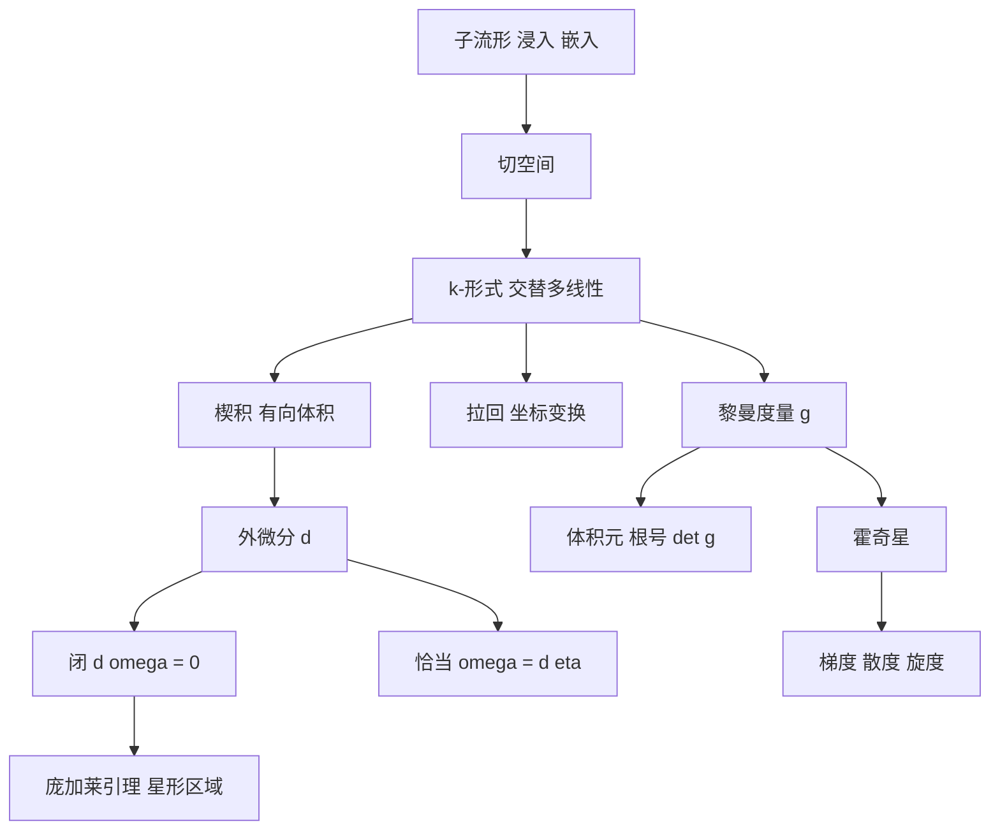

# 第 11 章：流形与微分形式

- **难度**：★★★ ｜ **预估学时**：16 小时 ｜ **前置**：第 7 章（多变量微分、流形）、第 8 章（线积分、普法夫形式）

> 原书把这一章定位成线积分的高维类比：第八章学了普法夫形式和线积分，这一章处理"高阶微分形式在 ℝⁿ 的某些子流形上积分"。换句话说，被积对象从 1-形式升级到 k-形式，积分区域从曲线升级到曲面。

## 学习目标

学完本章，你能：
1. 用坐标卡定义子流形，区分浸入与嵌入、带边流形。
2. 写出楔积的反对称性与外微分 d 的定义，判断形式是否闭、是否恰当。
3. 用拉回把 ℝⁿ 上的形式搬到流形上，说明定向的作用。
4. 写出黎曼度量的局部表示，用梯度、散度、旋度与霍奇星统一向量分析。

## 一句话核心

k-形式是"吃 k 个切向量、吐一个数"的反对称仪器；外微分 d 把 k-形式变成 (k+1)-形式，并让"闭"与"恰当"、局部与整体通过斯托克斯定理连接起来。

## 零基础讲解

### 概念 1：子流形、浸入、嵌入

m 维流形 M 是 ℝᵐ̄ 的子集，每点附近有坐标卡 (φ, U)，把 M ∩ U 拉平成 ℝᵐ 的开集。

L ⊆ M 是 ℓ 维子流形：对每个 p ∈ L，存在 M 的坐标卡使 φ(U ∩ L) = φ(U) ∩ (ℝℓ × {0})。也就是"局部看，L 就是 M 坐标里的一个平面"。

- **浸入**：f : M → N 的切映射 Tₚf 在每个 p 处单射（不压扁维度）。
- **嵌入**：浸入 + 到像的同胚（不自我相交、不把远处粘近）。
- **带边流形**：坐标卡取值在半空间 ℍᵐ = {x : xₘ ≥ 0}，边界是 xₘ = 0 的像。

**类比**：浸入像把一张纸弯成波浪放进盒子，局部不折叠；嵌入还要求纸不自交、不贴近自己。**边界**：浸入可以全局自交（如 8 字形曲线），这时它不是嵌入。

### 概念 2：多重线性代数：楔积

k-形式是交替 k-线性映射：交换两个自变量，符号变号。

ω(v₁, …, vₖ) = −ω(…, vⱼ, …, vᵢ, …)。

楔积：对 1-形式 α、β，α ∧ β(v, w) := α(v)β(w) − α(w)β(v)。它自动反对称，且 α ∧ β = −β ∧ α、α ∧ α = 0。

在坐标基下，dx¹ ∧ … ∧ dxᵏ 作用在向量组上就是"矩阵的行列式"。这解释了一个关键事实：**形式天然适合测量有向体积**。

**类比**：楔积像"带方向的平行四边形面积"。交换两条边，方向翻转，面积变号；两条边重合，面积为零。
**边界**：只有在有定向的空间里"变号"才有意义；无定向流形上，形式只能测"无向体积"的绝对值。

### 概念 3：外微分 d

对 k-形式 ω = Σ a_I dx^I，定义

dω := Σ da_I ∧ dx^I，

其中 da_I 是普通微分。三条性质：

1. d(dω) = 0（"边界的边界为空"）。
2. d 满足莱布尼茨律：d(ω ∧ η) = dω ∧ η + (−1)^k ω ∧ dη。
3. 拉回与 d 交换：d(f*ω) = f*(dω)。

**闭**：dω = 0。**恰当**：ω = dη。由 d² = 0，恰当必闭；反之在星形区域上闭必恰当（庞加莱引理），有洞时不成立。

1-形式的情形就是第 8 章的普法夫形式：ω = Σaⱼdxⱼ，dω = Σ(∂aⱼ/∂xₖ)dxₖ ∧ dxⱼ，闭性等价于 ∂aⱼ/∂xₖ = ∂aₖ/∂xⱼ。

**类比**：d 像"求边界"。一个区域的边界没有边界（闭合曲线），所以 d² = 0。**边界**：d² = 0 是代数的，不是几何的"边界无边界"的严格证明；后者要靠斯托克斯定理。

### 概念 4：向量场、内积、李导数

向量场 X 是每点给一个切向量。形式与向量场通过内积 ι_X 配对：ι_X ω 是把 X 塞进第一个变量后得到的 (k−1)-形式。

李导数 L_X ω 描述"沿 X 流动时 ω 的变化率"，嘉当公式：

L_X = d ι_X + ι_X d。

这条公式把"流动的变化"拆成"边界的内部"与"内部的边界"，是微分形式运算的核心恒等式。

### 概念 5：黎曼度量

黎曼度量是每点切空间上的正定内积 g。局部写成矩阵 gⱼₖ = g(∂ⱼ, ∂ₖ)，光滑对称正定。

它给出：

- 长度：‖v‖ = √(g(v,v))；
- 角度：cos θ = g(v,w)/(‖v‖‖w‖)；
- 体积元：√det(g) dx¹ ∧ … ∧ dxᵐ。

半黎曼（伪黎曼）度量只要求非退化，不要求正定；闵可夫斯基空间的时间分量取负号，是相对论的几何基础。

**类比**：度量是"每个点自带的一把尺子"。平面上的尺子处处相同，球面上的尺子随位置变，所以球面三角形的内角和大于 π。

### 概念 6：梯度、散度、旋度与霍奇星

在 ℝ³ 的欧氏度量下，三种经典算子可以统一写成：

- grad f ↔ df（0-形式变 1-形式）；
- curl X ↔ *d(X♭)（1-形式变 1-形式）；
- div X ↔ *d(*X♭)（1-形式变 0-形式）。

霍奇星 * 把 k-形式变成 (m−k)-形式，依赖度量与定向。于是"梯度–旋度–散度"不再是三个孤立公式，而是 d 与 * 的不同组合。这也是麦克斯韦方程组能用微分形式写成两行的原因。

## 图示

**看图说明**：左边是几何对象（流形与切空间），中间是代数对象（形式与 d），右边是度量结构（g 与 *）。第 12 章的积分会同时用到三者：在流形上积分 m-形式，被积对象来自中间，体积元来自右边。

## 类比与实例

**类比**：k-形式像"测量仪器"：1-形式测"沿方向的累积"，2-形式测"穿过面的通量"，3-形式测"体内的总量"。d 是把"测边界的仪器"升级成"测内部的仪器"。
**失效边界**：仪器必须有定向才能区分正负；在不可定向的流形（莫比乌斯带）上，最高阶形式的积分只能取绝对值。

**实例（可验证）**：极坐标下的面积形式。
x = r cos θ，y = r sin θ。dx = cos θ dr − r sin θ dθ，dy = sin θ dr + r cos θ dθ。
dx ∧ dy = (cos θ)(r cos θ) dr ∧ dθ − (−r sin θ)(sin θ) dθ ∧ dr = r(cos²θ + sin²θ) dr ∧ dθ = r dr ∧ dθ。
这正是换元公式里雅可比行列式 r 的来源，说明"形式自动带雅可比"。

## 常见误解

- **别以为"形式就是无穷小量"** — 实际上形式是作用在切向量上的线性函数，dx 不是"很小的 x"，而是"取 x 分量的仪器"。
- **别以为"闭形式一定恰当"** — 实际上只在单连通（星形）区域成立；绕洞的形式是反例。
- **别以为"浸入就是嵌入"** — 实际上浸入允许全局自交，嵌入还要求到像的同胚。
- **别以为"霍奇星与度量无关"** — 实际上 * 依赖度量与定向，换度量结果就变。

## 自测题（答案）

1. 关于外微分，正确的说法是？　A. d(dω) = ω　B. d(dω) = 0　C. d 只在 0-形式上定义　D. d 与拉回不可交换
   **答案**：B。**解析**：d² = 0 是外微分的代数性质；恰当形式必闭，但闭不一定恰当。

2. 极坐标下 dx ∧ dy 等于？　A. dr ∧ dθ　B. r dr ∧ dθ　C. r² dr ∧ dθ　D. dr ∧ dθ/r
   **答案**：B。**解析**：直接计算得 dx ∧ dy = r dr ∧ dθ，因子 r 就是极坐标换元的雅可比行列式。

3. 黎曼度量给出的体积元是？　A. det(g) dx　B. √|det(g)| dx¹∧…∧dxᵐ　C. trace(g) dx　D. ‖g‖ dx
   **答案**：B。**解析**：体积元是 √|det g| 乘以坐标形式的楔积；正定度量可以去掉绝对值。

## 复习锚点

- k-形式 = 交替 k-线性仪器；楔积给有向体积，交换自变量变号。
- d² = 0；恰当必闭，闭在星形区域上恰当。
- 度规给长度、角度、体积元；霍奇星把 grad/div/curl 统一成 d 与 * 的组合。
