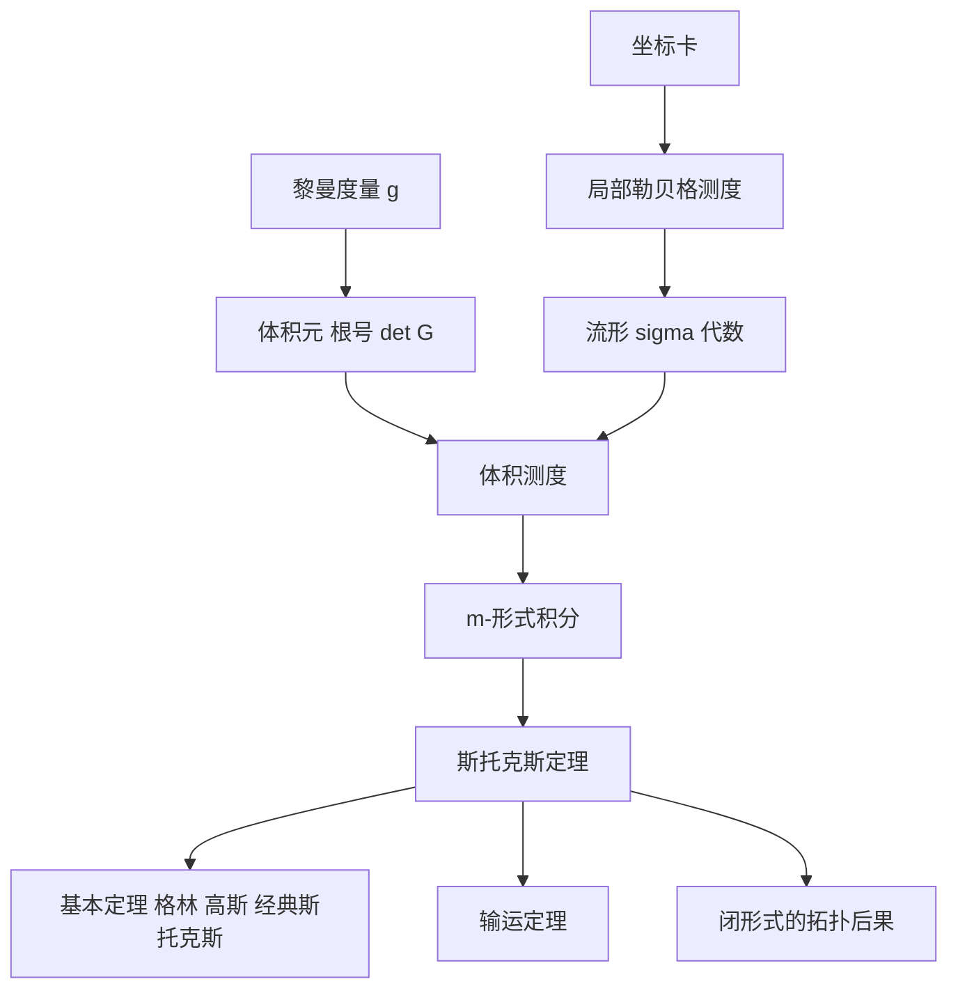

# 第 12 章：流形上的积分

- **难度**：★★★ ｜ **预估学时**：14 小时 ｜ **前置**：第 9 章（测度）、第 10 章（积分理论）、第 11 章（微分形式、度量）

> 原书在这一章开头说：前两章建立了测度与积分，上一章加深了对流形与微分形式的认识，现在准备把积分理论推广到流形上——也就是能在"弯曲空间"上积分。

## 学习目标

学完本章，你能：
1. 用坐标卡把 ℝᵐ 的勒贝格测度"抬"到流形上，说明为什么这个定义与坐标无关。
2. 用体积元 √|det g| dx¹∧…∧dxᵐ 计算曲面面积与流形体积。
3. 在流形上积分 m-形式，并用斯托克斯定理把闭路/闭面积分换成内部的 dω。

## 一句话核心

流形上的积分 = 局部坐标下普通积分 + 体积元修正；斯托克斯定理 ∮_∂M ω = ∫_M dω 把"边界上的积分"与"内部的微分"连成一条等式，是所有积分定理的统一形式。

## 零基础讲解

### 概念 1：把测度从 ℝᵐ 抬到流形

流形局部像 ℝᵐ 的开集，所以"可测"可以逐坐标卡定义：A ⊆ M 可测，如果对每个 p ∈ A，存在坐标卡 (φ, U) 使 φ(A ∩ U) 是 ℝᵐ 中的勒贝格可测集。

这个定义要证明与坐标卡选取无关：两套坐标之间的转换是微分同胚，而微分同胚把可测集映成可测集（第 10 章换元公式的推论）。于是得到流形上的 σ-代数 L_M，它包含博雷尔 σ-代数。

**类比**：给地球仪贴地图。每块小区域用一张平面地图描述，可测性就是"在这张地图上有面积"；换一张地图，面积仍然有定义，因为地图之间的转换是光滑可逆的。

### 概念 2：体积测度与体积元

给定（伪）黎曼度量 g，坐标卡 φ = (x¹, …, xᵐ)，格拉姆矩阵 G = (gⱼₖ)，体积元定义为

dV := √|det G| dx¹ ∧ … ∧ dxᵐ。

对 A ⊆ U，体积

vol(A) := ∫_{φ(A)} √|det G| dx。

引理：这个值与坐标卡的选择无关，因为坐标变换的雅可比行列式正好抵消 √|det G| 的变换因子。这正是第 10 章换元公式的用武之地。

特例：

- ℝᵐ 的欧氏度量：G = I，dV = dx，回到普通体积。
- 球面 S²：用球坐标，得 dV = R² sin θ dθ dφ，积分给出 4πR²。
- 图像 z = f(x,y)：dV = √(1 + |∇f|²) dx dy，这就是曲面面积公式。

**类比**：体积元是"每个点自带的缩放因子"。平面地图上的 1 平方厘米，在球面上可能对应不同的实际面积，√det G 就是换算率。

### 概念 3：m-形式的积分

在定向的 m 维流形 M 上，m-形式可以写成 ω = f dV（f 是光滑函数）。定义

∫_M ω := ∫_{φ(U)} f ∘ φ⁻¹ · √|det G| dx。

关键点：

1. 只有 m-形式（最高阶）能在 m 维流形上积分；低阶形式要沿子流形积分。
2. 定向决定符号：换定向，积分变号。
3. 拉回与换元保证定义与坐标无关。

1-形式沿曲线的积分就是第 8 章的线积分；2-形式沿曲面的积分就是通量；m-形式在 m 维区域上的积分就是"总量"。

### 概念 4：斯托克斯定理

设 M 是带边的定向 m 维流形，ω 是紧支集的 (m−1)-形式，则

∫_∂M ω = ∫_M dω，

其中 ∂M 继承 M 的诱导定向。

这是本章的高潮，也是全书积分理论的统一形式：

- 微积分基本定理：m = 1，∫_a^b f′ dx = f(b) − f(a)。
- 格林公式：平面区域，∮ P dx + Q dy = ∫∫(Q_x − P_y) dx dy。
- 高斯–奥斯特罗格拉德斯基：通量 = 散度的体积分。
- 经典斯托克斯：环量 = 旋度的通量。

证明思路：先用单位分解把 ω 的支集切成小块，每块落在坐标卡内；在坐标卡内把 ω 写成 (m−1)-形式，直接算 dω 的积分，用富比尼定理逐变量积分，边界项只剩两端，望远镜求和。单位分解的存在性来自第 10 章的磨光与卷积。

**类比**：斯托克斯定理像"记账对账"：边界上流进流出的净额，等于内部每个小格子的净产出之和。内部相邻格子的边界互相抵消，只剩最外圈。
**边界**：流形必须有边、可定向、ω 必须紧支集；带奇点（尖点、自交）时要额外处理，书中给出适用于常见奇点的版本。

### 概念 5：输运定理与通量

对随时间变化的区域或流场，雷诺输运定理说：

d/dt ∫_{M_t} f = ∫_{M_t} (∂f/∂t + div(fX))。

用微分形式写，就是李导数与内积的组合。它是流体力学与连续介质力学的基本公式，也是斯托克斯定理的直接应用。

### 概念 6：拓扑后果

斯托克斯定理给出"闭形式在闭流形上的积分"与"洞"的关系：若 ω 闭，则 ∫_M ω 只依赖 M 的同调类。这解释了为什么第 8 章绕洞积分是 2π，以及为什么"闭而不恰当"是拓扑现象而不是分析现象。

## 图示

**看图说明**：左支解决"在哪里积分"（测度），右支解决"积什么、怎么缩放"（度量与体积元），两支汇合成 m-形式积分，再由斯托克斯定理与边界连接。所有经典积分公式都是这条链的特例。

## 类比与实例

**类比**：在流形上积分像给一件衣服算布料总量。先把衣服剪成小片（坐标卡 + 单位分解），每片按当地的"松紧程度"（√det G）换算成实际面积，再加起来；斯托克斯定理说，如果你只关心边缘的缝合线，也能推出整件衣服的内应力总量。
**失效边界**：衣服不可定向（莫比乌斯带）时，"正反"没法定，只能用绝对值；有破洞时，闭形式的积分会留下洞的贡献。

**实例（可验证）**：球面面积。
球坐标 x = R sin θ cos φ，y = R sin θ sin φ，z = R cos θ。度量矩阵给出 √det G = R² sin θ。于是
面积 = ∫₀^{2π}∫₀^{π} R² sin θ dθ dφ = 2πR²·2 = 4πR²。
这个计算把"体积元"从一个抽象符号变成了具体的可算量。

## 常见误解

- **别以为"流形上的积分只是把 dx 换成 dV"** — 实际上体积元依赖度量，√det G 是必须算的因子，漏掉就得到平面面积。
- **别以为"斯托克斯定理只是向量分析的公式"** — 实际上它是对任意阶形式的统一陈述，格林、高斯、经典斯托克斯都是特例。
- **别以为"定向无关紧要"** — 实际上换定向积分变号；不可定向流形上只能积最高阶形式的绝对值。
- **别以为"闭形式积分总为 0"** — 实际上闭形式在带洞流形上的积分可以非零，这正是拓扑信息的来源。

## 自测题（答案）

1. 流形上体积元的表达式是？　A. dx¹∧…∧dxᵐ　B. √|det G| dx¹∧…∧dxᵐ　C. det(G) dx　D. √(trace G) dx
   **答案**：B。**解析**：体积元 = √|det G| 乘坐标楔积；欧氏度量为 1，球坐标为 R² sin θ。

2. 斯托克斯定理 ∫_∂M ω = ∫_M dω 中，ω 必须是？　A. 任意函数　B. (m−1)-形式　C. m-形式　D. 0-形式
   **答案**：B。**解析**：d 把 (m−1)-形式变成 m-形式，才能在 m 维 M 上积分；边界 ∂M 是 (m−1) 维，正好积 (m−1)-形式。

3. 球面 S² 的面积是？　A. 2πR²　B. 4πR²　C. 4πR³/3　D. πR²
   **答案**：B。**解析**：∫₀^{2π}∫₀^{π} R² sin θ dθ dφ = 4πR²。4πR³/3 是球的体积，不要混。

## 复习锚点

- 流形积分 = 坐标卡里的普通积分 + 体积元 √|det G|。
- 斯托克斯定理统一了基本定理、格林、高斯与经典斯托克斯。
- 定向决定符号；闭形式的积分携带洞的拓扑信息。
