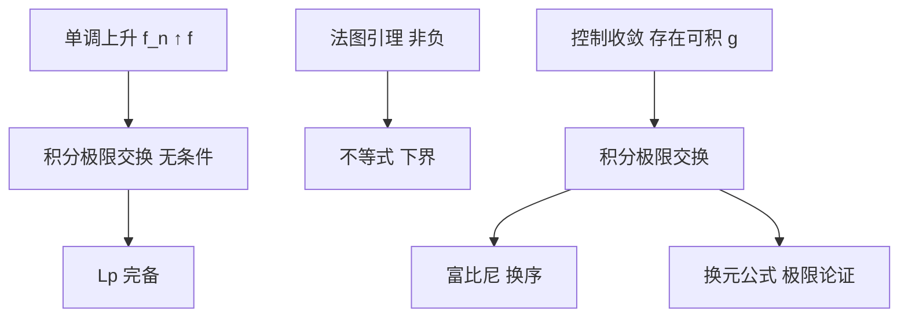

# 收敛定理（单调、法图、控制）

- **难度**：高难 ｜ **涉及章节**：第 10 章（§3）

## 一句话定义

三条定理给出"极限与积分交换"的条件：单调上升可无条件交换；非负情形有法图不等式；一般情形需要可积的控制函数。

## 为什么重要

这是勒贝格积分优于黎曼积分的核心。黎曼积分通常要一致收敛才能交换，勒贝格只要逐点收敛加一个控制。Lp 完备、富比尼换序、换元公式、傅里叶变换的连续性，全都靠它们。

## 图示

## 详解

单调收敛：0 ≤ fₙ ↑ f a.e. ⇒ ∫fₙ ↑ ∫f。允许两边都是 ∞。证明用 sup 的定义与简单函数逼近。

法图引理：fₙ ≥ 0 ⇒ ∫liminf fₙ ≤ liminf ∫fₙ。它不需要单调，但只给不等式。作用是给控制收敛提供下界估计。

控制收敛：fₙ → f a.e.，|fₙ| ≤ g a.e.，g 可积 ⇒ ∫fₙ → ∫f。证明对 |fₙ − f| 用法图引理，注意 |fₙ − f| ≤ 2g。

反例说明控制条件不能省：fₙ = nχ_{(0,1/n)}，逐点收敛到 0，∫fₙ = 1。不存在可积的 g 控制所有 fₙ。

**类比**：控制函数是"预算上限"。预算存在，支出才能随计划收敛；没有上限，某一期可以突然超支到无穷。
**边界**：控制函数必须可积，仅仅"逐点有界"不够（上面的反例逐点有界但无统一可积控制）。

## 常见误解

- 别以为"逐点收敛就能交换积分"——需要单调或控制。
- 别以为"控制函数可以依赖 n"——必须是同一个 g 控制所有 n。
- 别以为法图引理是等式——只有 ≤，等号需要额外条件。

## 在书中出现的脉络

| 章节 | 语境 | 关键结论 |
|---|---|---|
| 第 10 章 §2 | 积分定义 | 简单函数逼近取极限 |
| 第 10 章 §3 | 收敛定理 | 单调、法图、控制 |
| 第 10 章 §4 | Lp 完备 | 用控制收敛证柯西列收敛 |
| 第 10 章 §6 | 富比尼 | 换序需要可积性 |
| 第 10 章 §8 | 换元 | 对特征函数取极限 |

## 相关概念

- 前置：可测函数、积分定义
- 后续：Lp 空间、富比尼定理、傅里叶变换
