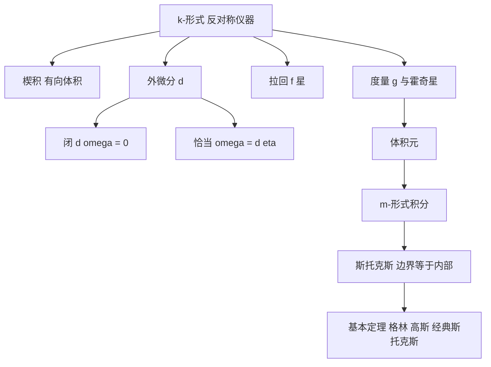

# 微分形式与斯托克斯定理

- **难度**：★★★ ｜ **涉及章节**：第 11 章（§2–§6）、第 12 章（§2–§3）

## 一句话定义

微分形式是反对称的多线性仪器，可以被拉回、被外微分；斯托克斯定理说，边界上的形式积分等于内部 dω 的积分。

## 为什么重要

它统一了所有积分定理，并把"局部微分"与"整体拓扑"联系起来。麦克斯韦方程组、流体力学、辛几何、指标定理，都用这套语言书写。

## 图示

## 详解

k-形式：交替 k-线性映射。楔积构造高阶形式，dx¹∧…∧dxᵏ 在向量组上取值等于行列式，所以形式天然测量有向体积。

外微分：d(Σa_I dx^I) = Σda_I ∧ dx^I。性质 d² = 0；恰当必闭；星形区域上闭必恰当。

拉回：f*ω 把 N 上的形式搬到 M 上，与 d 交换。它保证"在坐标卡里算"是合法的。

积分：m 维定向流形上积 m-形式；低阶形式沿相应维数的子流形积分。

斯托克斯：∫_∂M ω = ∫_M dω。证明用单位分解切小块，在坐标卡内用富比尼逐变量积分，边界项望远镜求和。

四个特例：微积分基本定理（m=1）、格林公式（平面）、高斯散度定理、经典斯托克斯（旋度）。

**类比**：d 是"取边界"的代数版本，斯托克斯定理说"数边界"与"数内部的小边界"结果相同，因为相邻小块的公共边界互相抵消。
**边界**：流形要可定向、有边、ω 紧支集；不可定向时只能取绝对值。

## 常见误解

- 别以为形式是"无穷小量"——它是作用在切向量上的函数。
- 别以为"闭 = 恰当"总成立——需要单连通。
- 别以为斯托克斯只是向量分析公式——它是任意阶形式的统一陈述。

## 在书中出现的脉络

| 章节 | 语境 | 关键结论 |
|---|---|---|
| 第 11 章 §2 | 多重线性代数 | 楔积、交替形式、霍奇星 |
| 第 11 章 §3 | 局部理论 | 外微分、闭与恰当 |
| 第 11 章 §4 | 向量场 | 内积、李导数、定向 |
| 第 12 章 §2 | 形式积分 | 拉回、体积元 |
| 第 12 章 §3 | 斯托克斯 | 统一四大积分定理 |

## 相关概念

- 前置：线积分、雅可比、流形、黎曼度量
- 后续：德拉姆上同调、辛几何、规范场论
