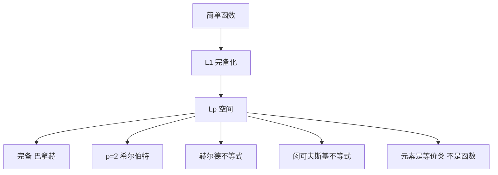

# Lp 空间

- **难度**：高难 ｜ **涉及章节**：第 10 章（§4）

## 一句话定义

Lp 是"p 次方可积"的函数等价类构成的空间，配 ‖f‖ₚ = (∫|f|ᵖ)^{1/p}；它完备，p = 2 时还是希尔伯特空间。

## 为什么重要

它是泛函分析、偏微分方程、概率论的通用舞台。完备性让"取极限"这件事在函数层面合法；赫尔德与闵可夫斯基不等式提供了全部估计工具。

## 图示

## 详解

定义：‖f‖ₚ = (∫|f|ᵖ dμ)^{1/p}（1 ≤ p < ∞）；p = ∞ 取本质上确界。

- 完备性：柯西列在 Lp 范数下收敛，用控制收敛/法图引理抽出几乎处处收敛的子列，再证范数收敛。
- 赫尔德：‖fg‖₁ ≤ ‖f‖ₚ‖g‖_q，1/p + 1/q = 1。它是柯西–施瓦茨的推广。
- 闵可夫斯基：‖f + g‖ₚ ≤ ‖f‖ₚ + ‖g‖ₚ，给出三角不等式，所以 Lp 是赋范空间。
- 稠密性：简单函数在 Lp 中稠密；p < ∞ 时紧支连续函数也稠密。
- 对偶：p 与 q 互为对偶指数，Lq 是 Lp 的对偶空间（p ∈ (1, ∞)）。

**等价类**：严格说 Lp 的元素是"几乎处处相等"的函数类。若把函数本身当元素，‖f‖ₚ = 0 不能推出 f = 0，三角不等式也会出问题。书中反复强调代表元与等价类的区别，这不是形式主义。

**类比**：Lp 像"按不同标准衡量的仓库"：L¹ 看总重量，L² 看总能量，L∞ 看最大单件。同一批货物在不同标准下的"大小"不同，但都可以比较、取极限。
**边界**：p 不同，空间不同；L² ⊂ L¹ 只在有限测度空间成立，在 ℝ 上不成立。

## 常见误解

- 别以为 Lp 的元素就是函数——是等价类。
- 别以为所有 Lp 互相包含——只在有限测度空间里 Lq ⊆ Lp（q > p）。
- 别以为 p = ∞ 是"p 趋于无穷的极限"那么简单——它是本质上确界，允许零测集上无界。

## 在书中出现的脉络

| 章节 | 语境 | 关键结论 |
|---|---|---|
| 第 10 章 §2 | 积分 | L1 完备化定义积分 |
| 第 10 章 §4 | Lp | 完备、赫尔德、闵可夫斯基 |
| 第 10 章 §7 | 卷积 | L1 ∗ Lp ⊆ Lp |
| 第 10 章 §9 | 傅里叶 | L² 上的酉性 |

## 相关概念

- 前置：测度、积分、完备性
- 后续：希尔伯特空间、傅里叶变换、索伯列夫空间
