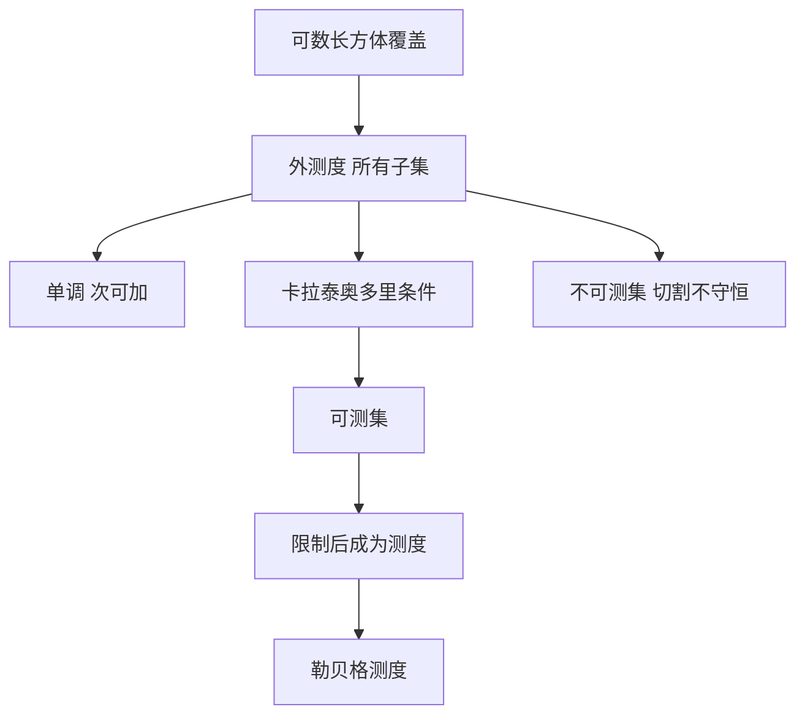

# 外测度与可测集

- **难度**：高难 ｜ **涉及章节**：第 9 章（§3–§4）

## 一句话定义

外测度是对所有子集都定义的"最小覆盖体积"；可测集是满足卡拉泰奥多里切割条件的集合，外测度限制在它们上面才成为真正的测度。

## 为什么重要

这是勒贝格测度的构造核心。它把"几何覆盖"与"可加性"分开：外测度负责赋初值，卡拉泰奥多里条件负责筛掉"切不干净"的集合。

## 图示

## 详解

外测度：λ*(A) = inf{Σvol(Qⱼ) : A ⊆ ∪Qⱼ}。

性质：λ*(∅) = 0；单调；次可加 λ*(∪Aⱼ) ≤ Σλ*(Aⱼ)。注意是"次可加"，不是可加——覆盖可以重叠，也可以包进空气。

卡拉泰奥多里条件：A 可测 ⇔ 对每个 T，λ*(T) = λ*(T ∩ A) + λ*(T ∩ Aᶜ)。

直觉：A 把任何测试集 T 切成两块，两块的外测度之和恰好等于整体。这条条件对不可测集失效——维塔利集合会把 T 切成"总量凭空多出来"的两块。

定理：可测集构成 σ-代数，λ* 限制在其上满足可数可加，于是成为测度 λ。

**类比**：外测度是"用包装纸包东西的最小用量"，可测集是"切割时不掉渣的材料"。只有后者能用来称重。
**边界**：外测度不是测度，不能直接对它用可加性；必须先筛可测集。

## 常见误解

- 别以为外测度满足可加性——它只次可加，反例来自覆盖重叠。
- 别以为"外测度为 0"就是可测——零外测度集一定是可测的（这是定理），但"外测度有限"不保证可测。
- 别以为卡拉泰奥多里条件是技术性装饰——它是整个构造的筛子，去掉就没有测度。

## 在书中出现的脉络

| 章节 | 语境 | 关键结论 |
|---|---|---|
| 第 9 章 §3 | 外测度 | 覆盖定义、次可加 |
| 第 9 章 §4 | 可测集 | 卡拉泰奥多里条件、σ-代数 |
| 第 9 章 §5 | 勒贝格测度 | 限制到可测集得到测度 |
| 第 10 章 §5 | 积分 | 可测性保证简单函数逼近 |

## 相关概念

- 前置：σ-代数、可数覆盖
- 后续：勒贝格测度、可测函数、L¹ 空间
