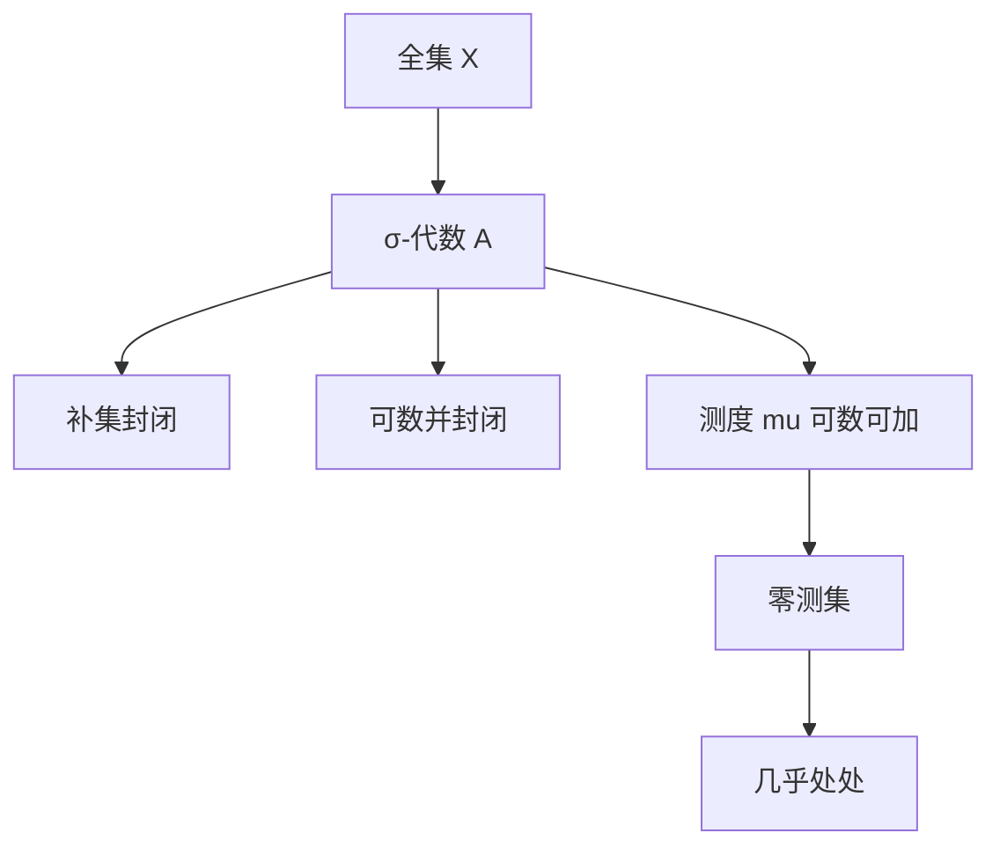

# σ-代数与测度

- **难度**：进阶 ｜ **涉及章节**：第 9 章（§1–§2）、第 10 章（§1）

## 一句话定义

σ-代数是对补集与可数并封闭的集合族，测度是定义在它上面的可数可加非负函数。

## 为什么重要

它规定了"哪些集合可以被测量"。没有这层限制，测度会与选择公理冲突。概率论、积分理论、流形上的体积，全都以测度空间为地基。

## 图示

## 详解

σ-代数三条：X ∈ A；A ∈ A ⇒ Aᶜ ∈ A；Aⱼ ∈ A ⇒ ∪Aⱼ ∈ A。由德摩根律，可数交也封闭。最小的例子是 {∅, X}；最大的例子是 P(X)（但上面不一定有有用的测度）。

测度 μ : A → [0, ∞] 要求 μ(∅) = 0，且对不交序列 μ(∪Aⱼ) = Σμ(Aⱼ)。由可数可加性得到单调性与次可加性：A ⊆ B ⇒ μ(A) ≤ μ(B)；μ(∪Aⱼ) ≤ Σμ(Aⱼ)。

完备化：把每个零测集的子集都加入 σ-代数，并赋予测度 0。得到的测度空间叫完备化。勒贝格测度就是博雷尔测度的完备化。

**类比**：σ-代数是一张"允许测量的清单"，测度是清单上每一项对应的"重量"。清单必须对"取补集""可数合并"封闭，否则算着算着就跑到清单外。
**边界**：清单不是越大越好——P(X) 上通常定义不出平移不变的可数可加测度。

## 常见误解

- 别以为 σ-代数就是"所有子集"——P(X) 是 σ-代数，但上面不一定有合适测度。
- 别以为"测度为 0"等于"空集"——康托集测度为 0 却不可数。
- 别以为"可加"可以换成"有限可加"——可数可加是勒贝格理论能做极限的关键。

## 在书中出现的脉络

| 章节 | 语境 | 关键结论 |
|---|---|---|
| 第 9 章 §1 | 可测空间 | σ-代数、博雷尔 σ-代数 |
| 第 9 章 §2 | 测度 | 可数可加、完备化 |
| 第 10 章 §1 | 可测函数 | 几乎处处、简单函数 |
| 第 12 章 §1 | 流形测度 | 局部坐标卡定义 L_M |

## 相关概念

- 前置：集合、可数性、拓扑
- 后续：外测度、勒贝格测度、Lp 空间
