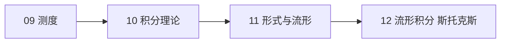

# 学习路径：《分析 III》

覆盖原书第 9–12 章：测度、积分理论、微分形式、流形积分。这是三卷中最抽象的一段，建议每章都先读"一句话核心"，再逐概念推进。

## 路径总览

## 步骤 9：测度

**目标**：能写出 σ-代数与测度公理，能解释外测度为什么要用卡拉泰奥多里条件筛可测集。
**阅读**：ch09-measure.md，配合「σ-代数与测度」「外测度与可测集」。
**检查点**：ch09 自测三题；能说明康托集为什么测度为 0。
**复习**：卡片标签「测度」。

## 步骤 10：积分理论

**目标**：能用简单函数逼近定义积分，能陈述并应用三大收敛定理，能说明 Lp 的等价类问题。
**阅读**：ch10-integration-theory.md，配合「收敛定理」「Lp 空间」。
**检查点**：ch10 自测三题；能构造控制收敛失效的反例。
**复习**：卡片标签「积分」「收敛定理」。

## 步骤 11：流形与微分形式

**目标**：能判断形式是否闭/恰当，能算极坐标下的 dx∧dy，能说明浸入与嵌入的差别。
**阅读**：ch11-manifolds-forms.md，配合「微分形式与斯托克斯定理」。
**检查点**：ch11 自测三题；能独立算出极坐标体积元。
**复习**：卡片标签「形式」「流形」。

## 步骤 12：流形上的积分

**目标**：能用体积元算球面面积，能写出斯托克斯定理并指出它是四个经典公式的统一。
**阅读**：ch12-manifold-integration.md。
**检查点**：ch12 自测三题；能复述单位分解在证明中的作用。
**复习**：卡片标签「斯托克斯」「计算」。

## 学完全程后

- 你能：独立读懂测度论的基本构造；用收敛定理论证极限交换；在具体流形上算体积与通量。
- 综合检验：选一个带洞区域（如 ℝ² 去掉原点），验证 ω=(xdy−ydx)/(x²+y²) 闭而不恰当，说明斯托克斯定理在该区域如何"失败"，并解释这个失败为什么是拓扑的而不是分析的。
